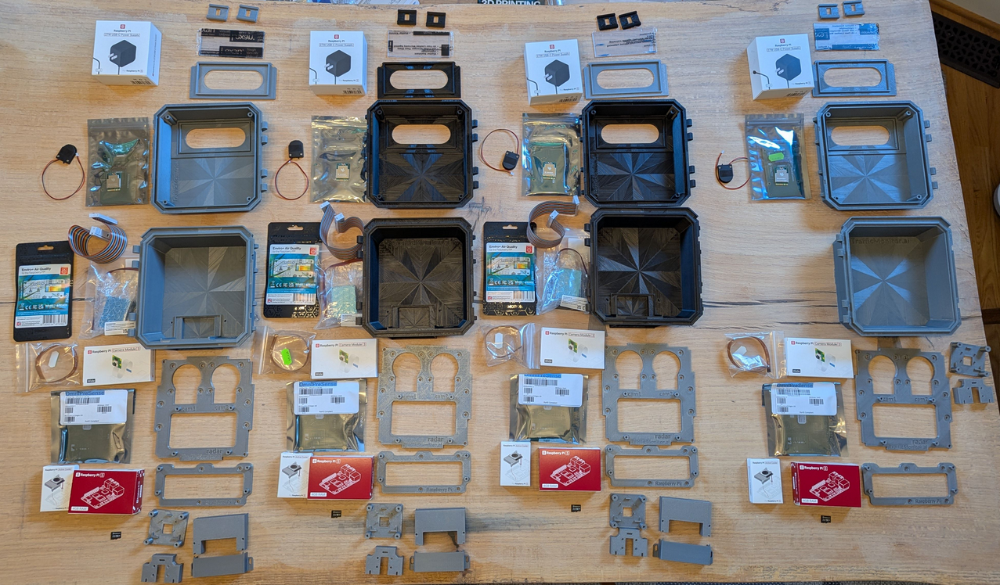
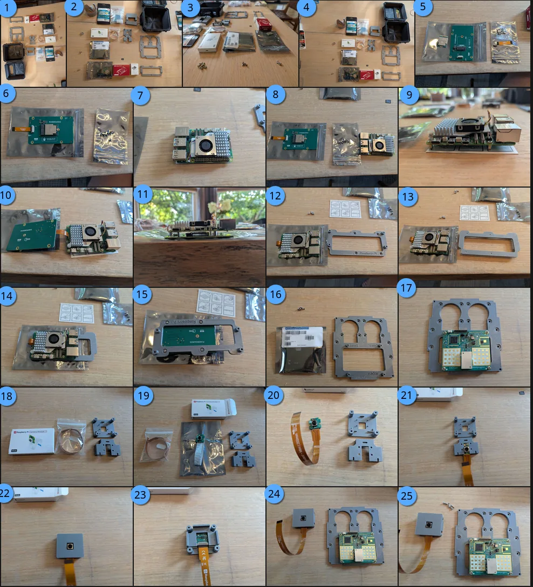
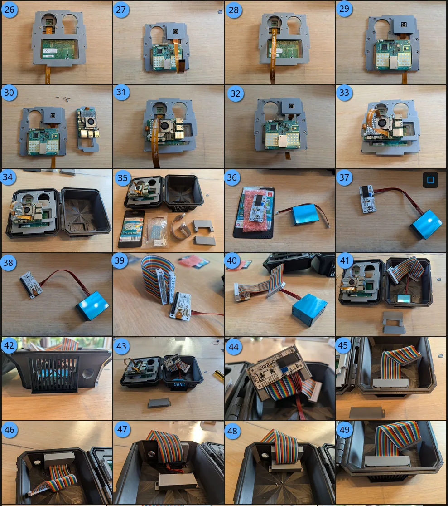
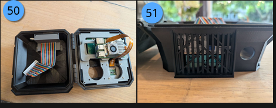
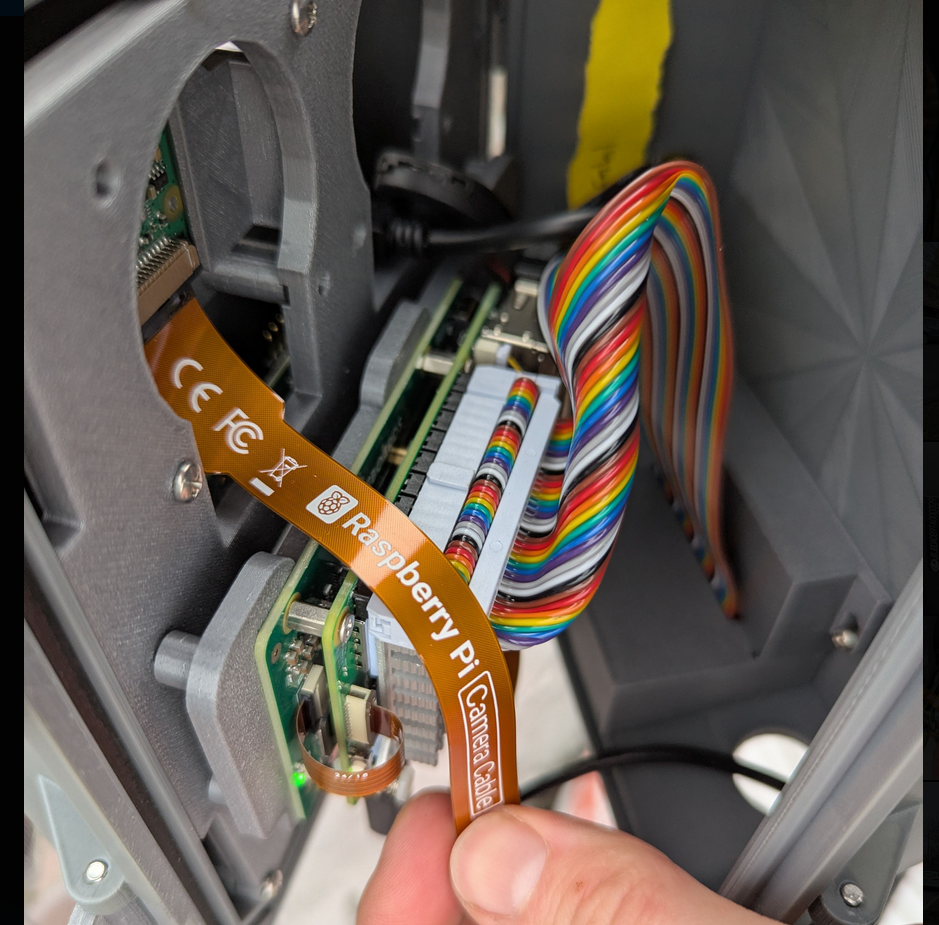
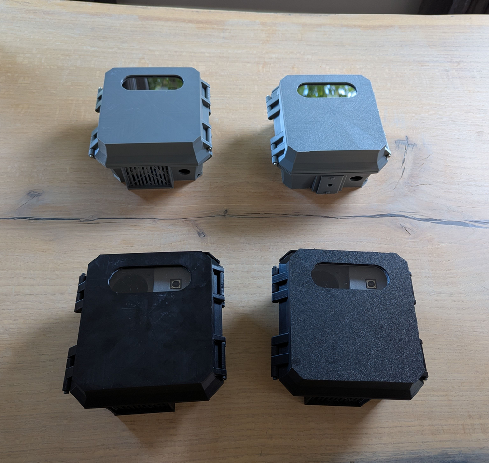

# Assembly

These steps assume the [parts list](recommended-hardware.md) and the 3D-printed enclosure. Each numbered step matches a numbered photo.

<figure markdown="span">
  
  <figcaption>Full set of Traffic Monitor parts ready for assembly</figcaption>
</figure>

Steps 1 to 34 assemble the Raspberry Pi 5, Camera Module 3, AI accelerator (Coral TPU HAT or AI HAT+), and radar. Steps 35 to 51 add the optional air quality sensor.

## Core parts

1. Lay out all your parts and screws
2. Lay out all your parts and screws (double-check)
3. M3×12 mm screws for the camera, M3×6 mm for the radar, M3×10 mm for the carrier board
4. Lay out all your parts and screws
5. (Coral TPU M.2 module and HAT pictured) Unbox the AI accelerator and the M.2 board, if separate
6. (Coral TPU M.2 module and HAT pictured) Attach the M.2 module to the board and attach the ribbon cable
7. Attach the active cooler to the Raspberry Pi
8. Lay out the HAT stand-offs
9. Attach the stand-offs to the board (bottom-HAT version shown)
10. Plug in the PCIe ribbon cable. _Match the triangle marks on the ribbon cable, the Raspberry Pi, and the HAT._
11. Attach the HAT to the Raspberry Pi (bottom HAT shown, for the Coral TPU)
12. Locate the Raspberry Pi carrier plate
13. Turn the carrier plate so the built-in stand-offs point down
14. Mount the Raspberry Pi and HAT to the carrier plate
15. Bottom of the carrier plate
16. Locate the radar and its mounting board
17. Attach the radar to the mounting board with M3×6 mm screws, with the antenna (the white and gold areas) at the bottom and the micro-USB plug near the camera cut-out
18. Locate the camera, camera mounts, and camera ribbon cable
19. If the camera came with a white ribbon cable, remove it. It doesn't fit the Raspberry Pi 5.
20. Attach the Raspberry Pi 5 camera ribbon cable to the camera
21. Slide the camera into the first camera mounting plate
22. Snap on the other camera mounting plate so all the holes and pins align
23. The camera mount stand-offs are on the back, and the first plate sits flush with the end of the stand-offs
24. Locate the main mounting board and the assembled camera mount
25. Locate four M3×12 mm screws for the camera
26. (Pictures continue below) Mount the camera in either of the camera mount holes
27. Radar and camera mounted, from the front
28. Pass the camera ribbon cable through the camera mounting hole to the back
29. Front view with the camera ribbon cable through the back
30. Locate the main mounting board, the carrier plate, and the M3×10 mm screws
31. Attach the carrier board to the main board
32. Front view with the carrier board attached
33. Plug the camera ribbon cable into either of the Raspberry Pi 5 camera connectors
34. Place the main mounting board into the enclosure, with the radar and camera at the top facing forward, and secure it with M3×10 mm screws in the four corners

## Air quality sensor

35. Locate the Enviro+ board and the particulate matter (PM) sensor
36. Unpack both
37. Attach the Enviro+ board to the PM sensor
38. Back of the Enviro+ board
39. Locate the GPIO ribbon cable
40. Attach the ribbon cable to the Enviro+ board with the wires going down and the notch on top
41. Place the PM sensor in its slot, pushed fully onto the pins in the bottom of the enclosure
42. The PM sensor from below
43. Slip the Enviro+ board into the air quality carrier board
44. Line up the pins on the bottom of the carrier board with the Enviro+ board. It may be snug.
45. Gently place the carrier board into the alignment slots in the enclosure
46. There should be almost no gap between the carrier board and the enclosure
47. Fold the ribbon cable up and tuck the PM sensor cable on top of the PM sensor
48. Slide the air quality shroud into its slots so you can see the screw inserts, and secure it with M3×8 mm screws
49. Front of the assembled sensor
50. Top of the assembled sensor
51. The assembled sensor from outside the enclosure

### Attach the GPIO ribbon cable

Attach the ribbon cable to the Raspberry Pi's GPIO pins with the notch on top.

<figure markdown="span">
  
  <figcaption>Attach the ribbon cable with the notch toward the outside of the Raspberry Pi</figcaption>
</figure>

* Pre-fold the cable so it lies flat when the case is closed.
* The connector is tight on the pins and close to the cooler's heatsink. Work it down a few millimeters at a time, side to side, until it's fully seated.
* To remove it, unplug the Raspberry Pi first. Slide a flat-head screwdriver between the connector and the plastic header and work the connector off a few millimeters at a time, taking care not to short the pins.

## Ready to deploy

Close the case. Next, [install the software](../software-installation.md).

<figure markdown="span">
  
  <figcaption>Traffic Monitors ready to count</figcaption>
</figure>
