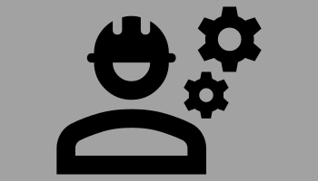
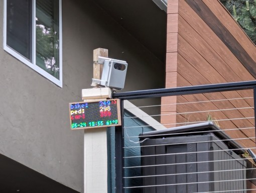

# Choose your path

## 1. Get a Traffic Monitor

-   

    **[Build your own](build-your-own-device-diy/README.md)**

    ---

    Buy the [hardware](build-your-own-device-diy/recommended-hardware.md), [assemble](build-your-own-device-diy/assembly-instructions.md) it, and [install the software](software-installation.md). The software is open source and the parts are sold at retail.

-   

    **Start with a pre-built unit**

    ---

    The software is installed. Skip to step 2, and ask your provider how the unit connects to your network.

## 2. Deploy it

The device needs a clear view of the roadway, and the radar needs a shallow angle to the direction of travel. [Choose a site and mount](deployment-and-mounting-guide.md) covers both, for [temporary](deployment-and-mounting-guide.md#temporary-deployments) and [permanent](deployment-and-mounting-guide.md#permanent-deployments) deployments.

## 3. Set it up

Power it on and follow [First-time setup](setup-guide.md): open the home page, turn on detection, adjust the zones to your roadway, and record the device's location. This takes about half an hour.

## 4. Use the data

The device counts around the clock and starts again by itself after a power cut. Watch the [Monitoring dashboard](ui/monitoring.md), review detections in Frigate, [export the data](ui/database.md), or send it to [ThingsBoard](data-and-payloads/integrations.md).

Some operators pair the device with a display that shows the day's counts. Share what you build in [Show and tell](https://github.com/glossyio/traffic-monitor/discussions/new?category=show-and-tell) or on the [Zulip chat](https://trafficmonitor.zulipchat.com/).

<figure markdown="span">
  
  <figcaption>LED display showing daily counts from a Traffic Monitor</figcaption>
</figure>
