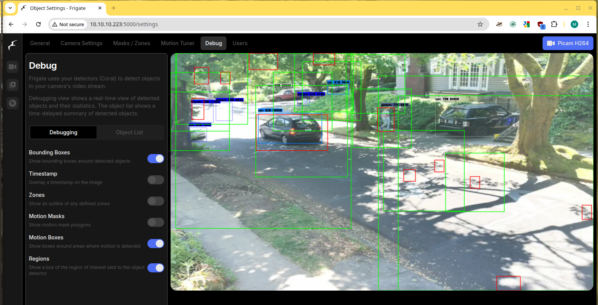

# Troubleshooting and FAQ

## Troubleshooting

??? question "The dashboard shows no counts"

    Follow the checklist in [First-time setup](../setup-guide.md#5-check-the-counts). The usual causes, in order: detection is off in Frigate, the objects don't pass through `zone_capture`, or the camera isn't enabled in `config.yml`.

??? question "Counts, but no speeds"

    The radar must be enabled in [config.yml](../configuration/node-red-config.md#sensorsradars) and named in the camera's `camera_radar`, `zone_radar` must cover the road, and the device must be at a shallow angle to the traffic. If the radar was plugged in after the software was installed, rerun `bash traffic-monitor/script/tmsetup.sh -t node-red-tm` so the container can see it.

??? question "Frigate shows no camera image"

    Open **Camera feeds** from the home page, logged in as the administrator. If the `picam_h265_detect` stream plays there, the camera and its stream work, and the fault is between Frigate and the stream. Either the camera is off in Frigate's configuration editor, where `cameras: picam_h265:` needs `enabled: true`, or Frigate's video decoding is failing, which shows as ffmpeg errors in the `frigate.service` log. If the stream doesn't play, check the camera cable, then look at the `go2rtc_server.service` log in [System administration](../use/system-admin.md).

??? question "Detection is slow or misses objects"

    Without an AI accelerator, Frigate detects on the CPU and can't keep up with a busy road. [Hardware](../build-your-own-device-diy/recommended-hardware.md#ai-accelerator) lists the supported accelerators. If you added one after installing, see [Add an accelerator later](../reference/tmsetup.md#add-an-accelerator-later). With an accelerator, see [Tune object detection](../configuration/frigate-config.md).

??? question "The first install seems stuck"

    Building Frigate's container image compiles ffmpeg on the device, which takes about 20 minutes with little output. Leave it running. The whole first install takes 30 minutes or more.

??? question "A database download fails"

    See [Data export](../ui/database.md#download-the-database).

??? question "I edited config.yml and nothing changed"

    The Traffic Monitor reads the file again when you save it, so a change that doesn't take effect usually means a YAML error, such as a wrong indent or a missing space after a colon. The `node-red-tm.service` log in [System administration](../use/system-admin.md) shows the error. Fix the file before you restart the service; [config.yml settings](../configuration/node-red-config.md) explains why.

## Privacy

### What does the device record?

The database records what passed (a label such as `car`), when, how fast, and through which zones. It holds no images and no plate numbers with the default settings. Frigate keeps a cropped snapshot and a short clip of each detection for about an hour, so you can check what it saw, and you can turn that off. By default, the device sends no images or video anywhere: everything is processed on the device, and the database holds only metadata. The live view, the recordings, and Frigate's snapshots are behind the device's [login](../use/control-app.md), which decides who on your network can open the apps. It isn't a control on the images themselves: anyone with an account can see them, and they're ordinary files on the device's card. [Data and privacy](../data-and-payloads/data-overview.md#privacy) explains, and lists the features that would change what's stored.

### Why this design?

The Traffic Monitor is built privacy-first because we believe in:

* **Ethical and transparent monitoring.** The code, the architecture, and the models are open, so anyone can see what the device does, and operators, especially public bodies, can be held to account.
* **Community safety and trust.** Detection runs on the device, nothing is sent to an outside server unless you set it up, and the data stays in your control.
* **Unbiased data collection.** Detection runs without human bias, but machine learning models can carry [algorithmic bias](https://en.wikipedia.org/wiki/Algorithmic_bias). We use public-domain and open source models wherever possible and name the models in use.

To keep an area out of view, aim the camera so the area is out of frame. A motion mask doesn't hide it; see [Data and privacy](../data-and-payloads/data-overview.md#privacy).

## Capacity

### How many objects can it track at once?

More than a busy street produces. The practical limit is objects hiding each other, as at the start of a race, where the camera can't see the person behind another.

The AI accelerator runs an inference in about 10 ms, which is about 100 inferences per second, and Frigate runs several inferences per frame when there's motion in several places. On a road with trees casting moving shadows, Frigate has been seen checking more than 18 motion regions and tracking 9 labeled objects at once, with inference time still around 9 ms. The video is decoded in hardware, and the CPU, which encodes the camera stream and runs motion detection, had headroom to spare. Frigate's discussions [#7491](https://github.com/blakeblackshear/frigate/discussions/7491) and [#18326](https://github.com/blakeblackshear/frigate/discussions/18326) explain how detections per frame are bounded.

<figure markdown="span">
  
  <figcaption>A road where shadows produce many motion regions, all checked for objects</figcaption>
</figure>
