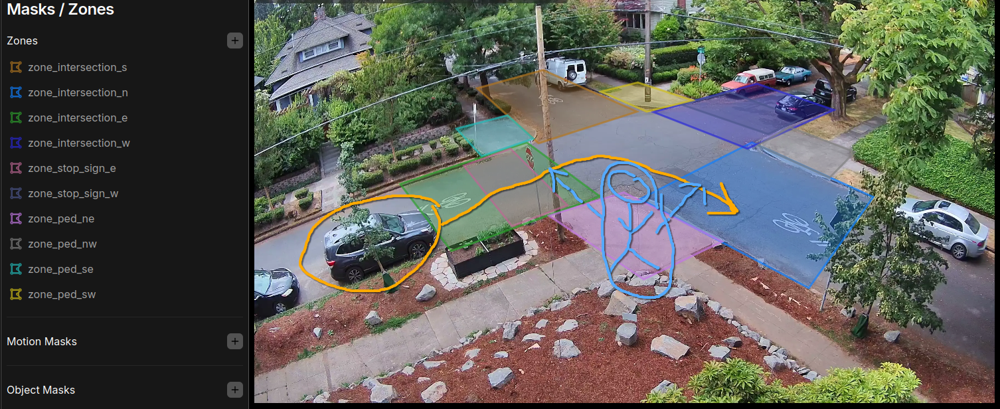
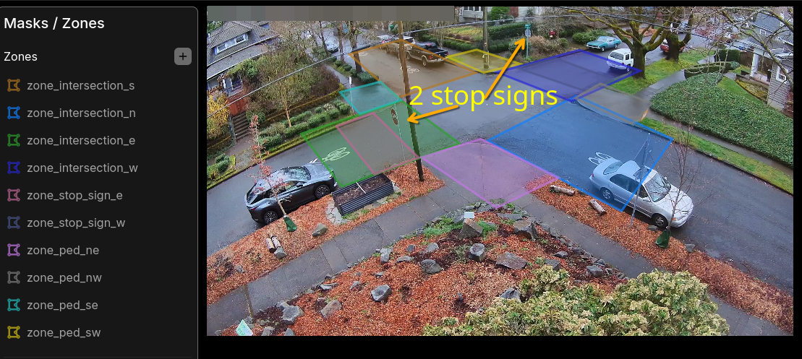
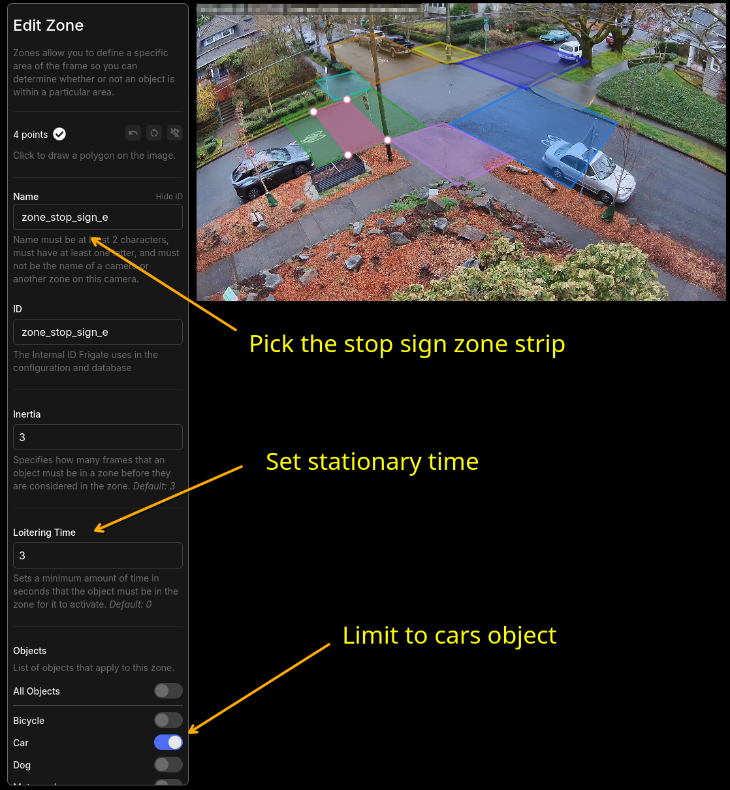
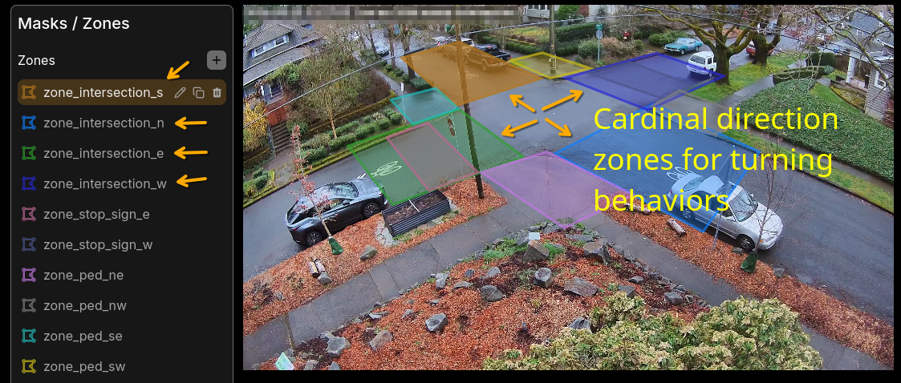
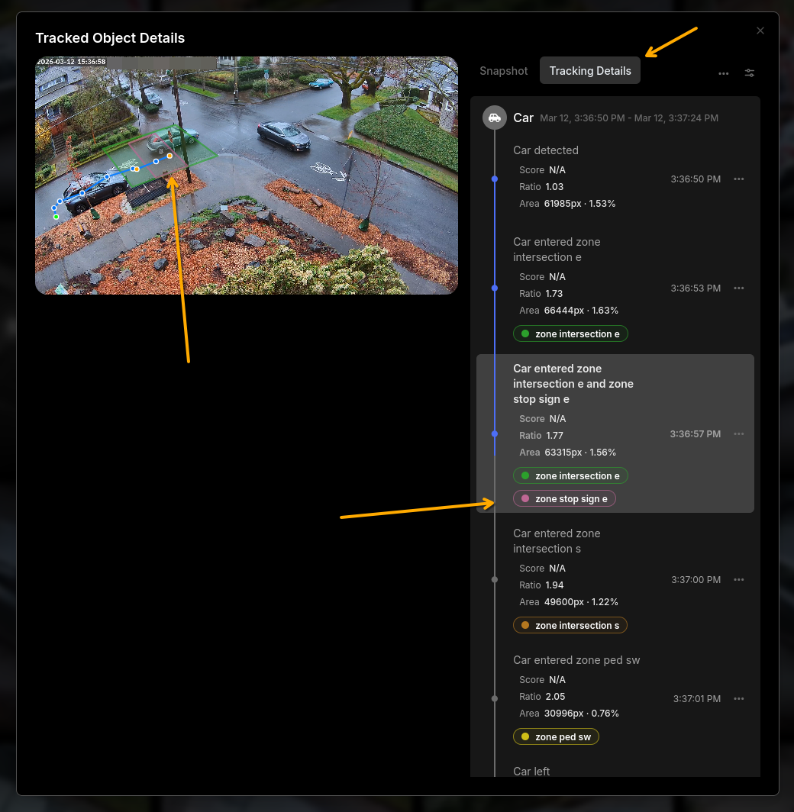

# Ideas and use cases

The device collects more than counts. With extra zones in Frigate and the [event data](../data-and-payloads/events-payload.md), you can study how people and vehicles interact. Three examples follow; share yours in [Show and tell](https://github.com/glossyio/traffic-monitor/discussions/new?category=show-and-tell).

## Near misses at a crosswalk

A near miss is a driver and a vulnerable road user, such as a pedestrian at a crosswalk, in conflict at the same moment. These events are rarely captured today. The first step is a definition, and traffic law supplies one. As an example, Oregon's rules, summarized by [Portland Bicycle School](https://portlandbicycleschool.com/driving-around-bicycles/driving-around-pedestrians-faq/):

* Every corner is a crosswalk (ORS 801.220).
* A pedestrian has claimed the crossing as soon as any part of them, or their cane, wheelchair, or bicycle, enters it (ORS 811.028(4), 814.040(1)(a)).
* A driver must stay stopped until the pedestrian has cleared the driver's lane, or the lane they're turning into, plus one more lane (ORS 811.028).

To capture conflicts:

1. Mount the device with a view of the whole intersection.
2. Draw zones for the pedestrian areas and the driver areas.
3. Each `person` and `car` event then records its `start_time`, `end_time`, and `entered_zones`.
4. Download the data and look for a car entering a driver zone while a person was in the conflicting pedestrian zone.

For example, a person in `zone_ped_ne` about to cross south or west, and a car that enters `zone_intersection_e` and turns into `zone_intersection_n` before the person has crossed, is a near miss or at least an illegal turn. You can tighten the definition further: was the car stationary at the stop sign first, or did a pedestrian zone at the very edge of the sidewalk show intent to cross? A `person` and a `car` in the same road zone at the same time is the most serious case.

<figure markdown="span">
  
  <figcaption>Zones for a near-miss study: pedestrian zones on each corner and intersection zones on each approach</figcaption>
</figure>

## Vehicles that don't stop at a stop sign

A rolling stop, also called a California stop or Rhode Island stop, is a vehicle that passes a stop sign without stopping fully or for the required time. Some places let cyclists treat a stop sign as a yield (the [Idaho stop](https://en.wikipedia.org/wiki/Idaho_stop)).

1. Mount the device high, looking down at the whole intersection.
2. In Frigate, draw a thin **stop-sign zone** across the road just before each stop sign, such as `zone_stop_sign_e` and `zone_stop_sign_w` for a two-way stop.

    

3. Give each stop-sign zone a [loitering time](https://docs.frigate.video/configuration/zones/#zone-loitering) that matches your jurisdiction, such as 3 seconds, and limit it to `car` if you like. The zone then appears in an event's `entered_zones` only if the vehicle stayed in it that long. A vehicle that rolled through has an event without the zone.

    

4. Optionally add wider zones for each approach, so you can also see turning movements: a car that went from `zone_intersection_e` to `zone_intersection_n` turned right.

    

5. Check the zones against a few real vehicles in Frigate's **Explore** view. It can take a while to find a car that stops properly.

    

### Without a loitering time

A second way needs no time chosen in advance. Give the stop-sign zone no loitering time and no side lengths for speed estimation. Every vehicle's event then has its seconds in the zone in `zone_times`, and how many of them it was stationary, so you can try one, two, or three seconds afterwards against the same events. [Time stopped and time in each zone](../data-and-payloads/events-payload.md#time-stopped-and-time-in-each-zone) has an example query.

Frigate's stationary flag is no help at a stop sign: it marks an object stationary only after about ten seconds without moving, which a full stop rarely lasts. The time in the zone is what to compare. A zone with a loitering time records only the time beyond it.

## How long vehicles stay parked

1. In Frigate, draw a zone over the parking bays, such as `zone_parking`, without side lengths for speed estimation.
2. A vehicle that parks and leaves is one event, saved when it leaves. Its `zone_times` has its time in the bay and how much of that it was stationary.

For a 15-minute bay, the vehicles that stayed longer than allowed are the events with more than 900 seconds stationary in the zone:

```sql
SELECT id,
       datetime(start_time, 'unixepoch', 'localtime') AS arrived,
       json_extract(zone_times, '$.zone_parking.stationary') AS seconds_parked
FROM events
WHERE json_extract(zone_times, '$.zone_parking.stationary') > 900
ORDER BY start_time;
```

The limits:

- Six hours is the most a figure says; 21600 means six hours or more.
- A vehicle that was already parked when the device started, or is still parked, has no event yet.
- If Frigate loses sight of a parked vehicle and finds it again, it is recorded only from where it was found.
