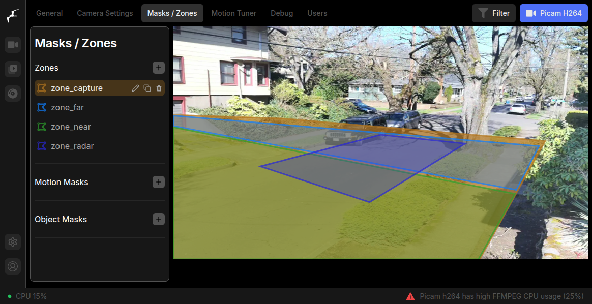

# First-time setup

Do these steps once the device is [mounted](deployment-and-mounting-guide.md) and powered on, and again whenever you move it. You need a computer or phone on the same network or on the device's own hotspot, and the device's setup code or administrator login. A device without a radar also needs an SSH client for step 4.

As installed, the camera and the first radar are turned on in the Traffic Monitor's settings, but Frigate's object detection is off. Nothing is counted until you turn it on in step 2.

## 1. Claim the device

Open `http://<device>/`, where `<device>` is the hostname you set when imaging the card followed by `.local`, or the device's IP address. [Home page and apps](use/home-page.md) explains each link and how to find the address.

A device at the roadside has no network to join. If its Wi-Fi isn't on a network it knows, it runs its own hotspot, named `TM-` and four characters. Join it with the password from the device's card; your phone's sign-in window then opens the setup page by itself, or you can open `http://10.42.0.1/`. [Wi-Fi and the hotspot](use/wifi-hotspot.md) has the details, including what to do on an iPhone or an Android 17 phone.

A device you didn't give a Wi-Fi network when imaging the card is reached through its hotspot. Join it, finish setup below, and then put the device on the network it will use: as the administrator, open **Network**, choose **Refresh**, pick the network, and type its password. The device tests the network and switches to it after a five-minute countdown; [Put the unit on a Wi-Fi network](use/wifi-hotspot.md#put-the-unit-on-a-wi-fi-network) walks through it. A Wi-Fi network you set in Imager works too, and shows up on that page as a saved network.

A device that hasn't been claimed opens its setup page:

1. Choose **Start setup**, and read and accept the license agreement.
2. Enter the setup code from the end of the installer's output, or from the card that came with a pre-built unit. `sudo tm-control card` on the device shows it again.
3. Create the administrator account with a username and password, and choose **Claim this device**.
4. Optionally, set a new system password for Cockpit and SSH.

[Control app and login](use/control-app.md) explains each step, and how to add accounts for other people. If the device was claimed already, log in as the administrator.

## 2. Turn on detection

1. Open **Frigate** from the home page, logged in as the administrator.
2. Go to **Settings > Configuration editor**.
3. Under `cameras: picam_h265: detect:`, change `enabled: false` to `enabled: true`.
4. Choose **Save & Restart**.

When Frigate is back, its live view draws a box around anything that moves past the camera.

## 3. Adjust the zones

The Traffic Monitor looks for four zones with fixed names. Frigate ships with all four drawn for a sample roadway; drag their corners to fit yours.

1. In Frigate, go to **Settings > Camera configuration > Masks / Zones**.
2. Edit each zone in the table below, then save. Frigate restarts.

| Zone | Draw it over | Used for |
|---|---|---|
| `zone_capture` | The whole roadway you want to count, including sidewalks that are clearly in view | Counting. An object is counted only if it passes through this zone. |
| `zone_near` | The half of `zone_capture` closest to the device | Direction |
| `zone_far` | The half of `zone_capture` farthest from the device | Direction. An object that enters `zone_near` and then `zone_far` is moving **outbound**, away from the device; the reverse is **inbound**. |
| `zone_radar` | The part of the road the radar covers accurately, roughly a rectangle from curb to curb in the middle of the frame. Keep it on a device without a radar too: draw it where you can measure the road, and give it the lengths of its sides if Frigate is to estimate speeds; see [Speed without a radar](configuration/frigate-config.md#speed-without-a-radar). | Speed statistics. Any object that enters a zone gets a speed from the radar, but the dashboards' speed statistics use only objects that passed through this zone. [Radar considerations](deployment-and-mounting-guide.md#radar-considerations) shows how to find the radar's coverage. |

<figure markdown="span">
  
  <figcaption>The four zones drawn over a residential street</figcaption>
</figure>

Zones you draw for your own analysis, such as a stop-sign zone or a crosswalk, can have any other name. [Ideas and use cases](help-and-faq/use-cases-and-scenarios.md) has examples. A zone's name is saved with every event that enters it and shared with the data, so name it for a direction or a lane, such as `zone_north` or `zone_lane_bus`, not for a street, an address, or a person; see [Zone names are saved with your data](use/cameras.md#zone-names-are-saved-with-your-data).

### At an intersection

Where the camera's view takes in a crossing, the radar can't tell one street from the other. A vehicle on the crossing street, or one that turns, can send readings that land on an event on the street you count. Draw the zones so that the radar's speeds belong to that street:

* Point the unit along one street, the one your zones count. Draw `zone_near`, `zone_far`, and `zone_radar` on that street, one after the other and all short of the crossing, where no cross traffic or turning vehicle passes.
* Keep `zone_capture` on that street too when speeds matter more to you than a count of the whole intersection.
* Give `zone_radar` the lengths of its sides, so that Frigate's own speed is recorded beside the radar's; see [Speed without a radar](configuration/frigate-config.md#speed-without-a-radar). Where the two disagree widely, the radar's reading was probably another vehicle's.
* For turning counts, add a zone on each leg of the crossing, named for its compass direction: `zone_north`, `zone_south`, `zone_east`, and `zone_west`. The [Movements](ui/movements.md) page counts vehicles by the zones they passed through.

<figure markdown="span">
  
  <figcaption>Zones for a unit that looks along one street toward a crossing. The dashed leg zones are optional.</figcaption>
</figure>

Then record that the camera's view takes in an intersection. The control app has no tick box for it yet, so set it by hand: add `intersection: true` to the camera's `deployment:` block in `config.yml`, as in [How a sensor is mounted](configuration/node-red-config.md#how-a-sensor-is-mounted). On a camera with a radar, a radar speed then goes only to an event that entered `zone_radar` and moved the way the radar saw. An event that never entered `zone_radar`, such as a vehicle seen only in a leg zone, gets no radar speed, and its `direction_source` is `zones_intersection`. Frigate's own speed still fills in wherever Frigate measured one. [Direction and speed](data-and-payloads/events-payload.md#direction-and-speed) has the details.

## 4. Record the location and sensors

The installer leaves the device's time zone as Raspberry Pi OS or Raspberry Pi Imager set it, and the dashboards show times in that zone. Whether or not you record a location, open **Date and time** in the control app as the administrator and check that the zone is the one where the device stands; [the Date and time page](use/device-health.md#the-date-and-time-page) explains how to change it.

The location is optional. If the device stays in one place and you never share its data, it can count without one. To record where the device is and which way it faces:

1. Open **Location** from the control app's menu, as the administrator.
2. Choose **Add a place**. Enter a description that only you see, paste the latitude and longitude from any maps app, and choose which way each sensor faces, as a compass point. Choose **Save**.
3. Open the new place in the list, choose **Deploy here**, check the review, and choose **Deploy**.

To record the way the sensors face, and how the unit is mounted, choose **Mounting** on the place in use, **First location**, and fill in the page. Set each sensor's heading on its dial, then its height above the road and its tilt or the distance to the centre of its view, or start from a usual mount. The page records no roll, so level the camera from side to side when you mount it. [Places and location](use/location.md) explains each step, and how precisely the database stores the location.

Then check that the sensors in the Traffic Monitor's settings match the hardware. A device with the Pi camera and one radar needs no change. On a device without a radar, open **Cameras** in the control app, open the camera's **Settings**, and set **Radar** to **No radar**. The camera's other settings are there too, and [Cameras](use/cameras.md) explains them. Turning off the radar itself takes a line in the settings file, so connect over SSH and open it:

```bash
sudo nano /opt/traffic-monitor/node-red-tm/config/config.yml
```

The camera and radar, as installed. A device without a radar needs `enabled: false` under `TM_RADAR_SERIAL_PORT_00`:

```yaml
sensors:
    cameras:
        picam_h265:
            enabled: true
            camera_radar: TM_RADAR_SERIAL_PORT_00
    radars:
        TM_RADAR_SERIAL_PORT_00:
            enabled: true
```

Save with Ctrl+O and leave nano with Ctrl+X. The Traffic Monitor reads the file again as soon as you save it, so no restart is needed. A change that doesn't take effect usually means a YAML error, such as a wrong indent.

[config.yml settings](configuration/node-red-config.md) describes every setting in this file, including the optional [ThingsBoard](data-and-payloads/integrations.md) upload.

## 5. Check the counts

Open **Dashboard** from the home page and choose **Monitoring** in the sidebar. [Monitoring](ui/monitoring.md) shows a count a few seconds after each object passes through `zone_capture`, and speed statistics for objects that also passed through `zone_radar`. Today's counts start at 04:00 local time, so between midnight and 04:00 they're empty.

??? question "No counts?"

    Work down the list:

    1. **Frigate shows no boxes around moving objects.** Detection is off (step 2), or the camera is off: in the configuration editor, `cameras: picam_h265:` needs `enabled: true`. If the live view is black, open **Camera feeds** from the home page to check that the camera itself streams.
    2. **Frigate detects objects, but the dashboard stays at zero.** The objects aren't passing through `zone_capture` (step 3), or the camera isn't recorded: on the control app's [Cameras page](use/cameras.md), the camera needs **Frigate detection** and **Database capture** on, and Frigate's camera must have an entry, or the page shows it as new in Frigate. If your edits in the settings file don't take effect, check it for a YAML error.
    3. **Counts but no speeds.** The radar must be `enabled: true` and named in the camera's `camera_radar`, `zone_radar` must cover the road, and the radar must have been plugged in when the software was installed. If you added it later, rerun `bash traffic-monitor/script/tmsetup.sh -t node-red-tm`.
    4. **Still nothing.** Look at the logs in [System administration](use/system-admin.md), then ask in the [chat](help-and-faq/where-can-i-get-support.md).
