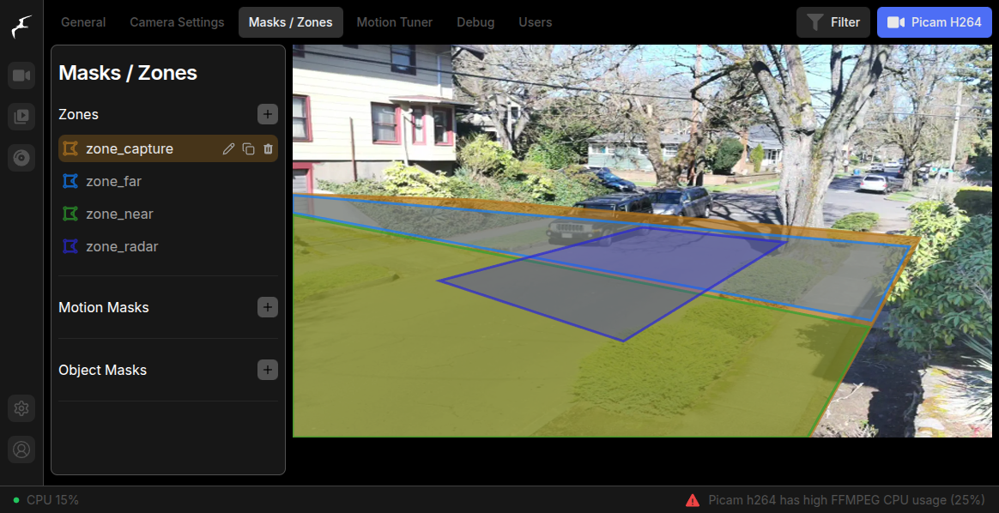

# First-time setup

Do these steps once the device is [mounted](deployment-and-mounting-guide.md) and powered on, and again whenever you move it. You need a computer or phone on the same network, and an SSH client for step 4.

As installed, the camera and the first radar are turned on in the Traffic Monitor's settings, but Frigate's object detection is off. Nothing is counted until you turn it on in step 2.

## 1. Open the home page

Open `http://<device>/`, where `<device>` is the hostname you set when imaging the card followed by `.local`, or the device's IP address. [Home page and apps](use/home-page.md) explains each link and how to find the address.

## 2. Turn on detection

1. Open **Frigate** from the home page.
2. Go to **Settings > Configuration editor**.
3. Under `cameras: picam_h265: detect:`, change `enabled: false` to `enabled: true`.
4. Choose **Save & Restart**.

When Frigate is back, its live view draws a box around anything that moves past the camera.

## 3. Adjust the zones

The Traffic Monitor looks for four zones with fixed names. Frigate ships with all four drawn for a sample roadway; drag their corners to fit yours.

1. In Frigate, go to **Settings > Camera configuration > Masks / Zones**.
2. Edit each zone in the table below, then save. Frigate restarts.

| Zone | Draw it over | Used for |
|---|---|---|
| `zone_capture` | The whole roadway you want to count, including sidewalks that are clearly in view | Counting. An object is counted only if it passes through this zone. |
| `zone_near` | The half of `zone_capture` closest to the device | Direction |
| `zone_far` | The half of `zone_capture` farthest from the device | Direction. An object that enters `zone_near` and then `zone_far` is moving **outbound**, away from the device; the reverse is **inbound**. |
| `zone_radar` | The part of the road the radar covers accurately, roughly a rectangle from curb to curb in the middle of the frame. Skip it if the device has no radar. | Speed statistics. Any object that enters a zone gets a speed from the radar, but the dashboards' speed statistics use only objects that passed through this zone. [Radar considerations](deployment-and-mounting-guide.md#radar-considerations) shows how to find the radar's coverage. |

<figure markdown="span">
  
  <figcaption>The four zones drawn over a residential street</figcaption>
</figure>

Zones you draw for your own analysis, such as a stop-sign zone or a crosswalk, can have any other name. [Ideas and use cases](help-and-faq/use-cases-and-scenarios.md) has examples.

## 4. Record the location and sensors

The device records its location with every event, so set it before you collect data. Connect over SSH and open the Traffic Monitor settings file:

```bash
sudo nano /opt/traffic-monitor/node-red-tm/config/config.yml
```

1. Under `deployment`, enter the latitude and longitude from any map service, and the compass direction the camera faces as `n`, `s`, `e`, `w`, `ne`, `nw`, `se`, or `sw`.
2. Under `sensors`, check that the entries match the hardware. A device with the Pi camera and one radar needs no change. A device without a radar needs `enabled: false` under `TM_RADAR_SERIAL_PORT_00`.

```yaml
deployment:
    lat: 45.5225
    lon: -122.6919
    bearing: n

sensors:
    cameras:
        picam_h265:
            enabled: true
            camera_radar: TM_RADAR_SERIAL_PORT_00
    radars:
        TM_RADAR_SERIAL_PORT_00:
            enabled: true
```

Save with Ctrl+O and leave nano with Ctrl+X. The Traffic Monitor reads the file again as soon as you save it, so no restart is needed. A change that doesn't take effect usually means a YAML error, such as a wrong indent.

[config.yml settings](configuration/node-red-config.md) describes every setting in this file, including the optional [ThingsBoard](data-and-payloads/integrations.md) upload.

## 5. Check the counts

Open **Dashboard** from the home page and choose **Monitoring** in the sidebar. [Monitoring](ui/monitoring.md) shows a count a few seconds after each object passes through `zone_capture`, and speed statistics for objects that also passed through `zone_radar`. Today's counts start at 04:00 local time, so between midnight and 04:00 they're empty.

??? question "No counts?"

    Work down the list:

    1. **Frigate shows no boxes around moving objects.** Detection is off (step 2), or the camera is off: in the configuration editor, `cameras: picam_h265:` needs `enabled: true`. If the live view is black, open **Go2RTC Feeds** from the home page to check that the camera itself streams.
    2. **Frigate detects objects, but the dashboard stays at zero.** The objects aren't passing through `zone_capture` (step 3), or the camera is off in the Traffic Monitor's settings: `sensors: cameras: picam_h265:` needs `enabled: true`, and the name must match Frigate's camera name. If your edits don't take effect, check the file for a YAML error.
    3. **Counts but no speeds.** The radar must be `enabled: true` and named in the camera's `camera_radar`, `zone_radar` must cover the road, and the radar must have been plugged in when the software was installed. If you added it later, rerun `bash traffic-monitor/script/tmsetup.sh -t node-red-tm`.
    4. **Still nothing.** Look at the logs in [System administration](use/system-admin.md), then ask in the [chat](help-and-faq/where-can-i-get-support.md).
