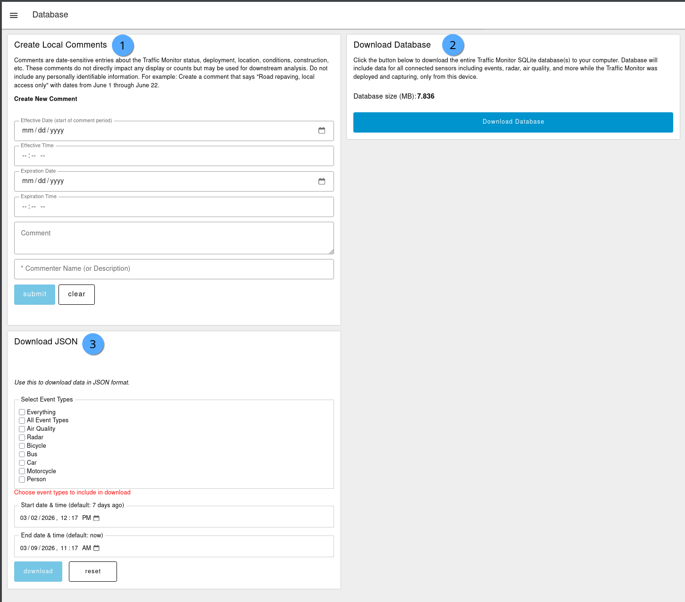

# Data export

Open `http://<device>/dashboard/database`, or **Database** in the dashboard's sidebar. This page gets data off the device and lets you leave notes in it. Both downloads need the device's administrator login; a [viewer](../use/control-app.md#administrators-and-viewers) can open the page but not download.

<figure markdown="span">
  
  <figcaption>The Data export page</figcaption>
</figure>

## Comments

A comment is a timestamped note stored in the `comments` table, for whoever analyzes the data later: a settings change, road work, an event in the area. Give it an effective date and an optional expiry date, the text, and your name; only the name is required. The form also has time fields, but only the dates are kept. Without an effective date, the comment takes effect when you save it. [Data and privacy](../data-and-payloads/data-overview.md#comments) lists the columns.

## Download the database

Downloads the whole database as a compressed archive named `<hostname>_<time>_tmdb.tar.gz`. The page shows the database's size in megabytes. The device first makes a consistent copy of the database, so a large one can take a minute or two before the download starts. The copy needs free space about the size of the database; if there isn't enough, the page says so. A 3 GB file can then take about 5 minutes to compress and several more to download. Cancel also works while the copy is being made: the download stops once the copy is done, and no archive is sent. If a download fails, you see the reason instead of a broken file.

Unpack the archive with `tar -xvzf` on Linux or Mac, or with [7-Zip](https://www.7-zip.org/) on Windows. Inside is `tmdb.sqlite`, which opens in [DB Browser for SQLite](https://sqlitebrowser.org/) or any SQLite library.

## Download JSON

Exports part of the data as JSON files in a compressed archive named `<hostname>_<time>_json.tar.gz`. Choose what to export and a start and end time, which default to the last 7 days:

| Choice | Contents |
|---|---|
| Everything | The `events` table, the five radar tables, and the `airquality` table |
| All event types | The whole `events` table for the time range |
| One object type, such as `car` or `person` | The events of that type |
| Air quality | The `airquality` table |
| Radar | The radar tables |

The files are plain JSON, readable in any text editor or loaded straight into a notebook.
