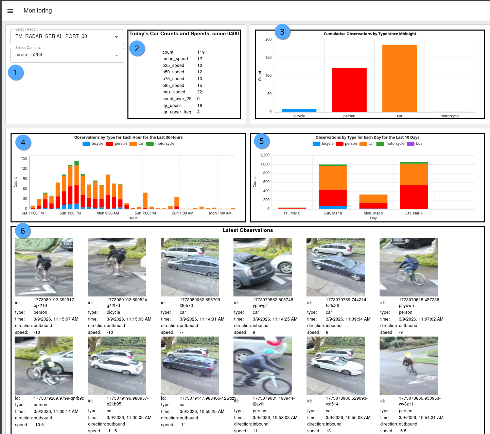

# Monitoring

Open **Dashboard** from the home page, or `http://<device>/dashboard/monitoring`. Monitoring shows the counts and speed statistics for one camera and one radar at a time.

<figure markdown="span">
  
  <figcaption>The Monitoring page, numbered as in the list below</figcaption>
</figure>

1. **Sensor selection.** Choose the radar and camera to show, on a device with more than one. Sensors must be enabled in [config.yml](../configuration/node-red-config.md#sensorscameras).
2. **Car speed statistics** since 04:00 local time, for `car` events that passed through both `zone_capture` and `zone_radar` and got a speed from the radar. Speeds are absolute values, so inbound and outbound are pooled. Percentiles are approximated from 20 speed buckets and rounded.

    | Statistic | Meaning |
    |---|---|
    | `count` | Cars with a speed |
    | `mean_speed` | Average speed |
    | `p25_speed`, `p50_speed`, `p75_speed`, `p85_speed` | 25th, 50th (median), 75th, and 85th [percentile](https://en.wikipedia.org/wiki/Percentile) speeds. The 85th percentile is the usual basis for speed limits. |
    | `max_speed` | Fastest car |
    | `count_over_25` | Cars faster than 25, in the radar's units |
    | `iqr_upper` | The outlier line: `p75_speed` plus 1.5 times the [interquartile range](https://en.wikipedia.org/wiki/Interquartile_range) |
    | `iqr_upper_freq` | Cars faster than `iqr_upper`, the outliers |

3. **Today's counts** by object type since 04:00 local time, for events that passed through `zone_capture`.
4. **Hourly counts** by object type for the last 36 hours.
5. **Daily counts** by object type for the last 10 days.
6. **Latest observations.** The 21 most recent events that passed through `zone_radar`, newest first. Each card shows Frigate's snapshot, the direction, the speed, how many radar readings matched, the range of radar magnitudes and speeds, and two charts, **Radar Magnitude** and **Radar Speed**, over the time the object was in view. The charts show whether the speed came from a clean set of readings or from several objects at once.

Counts and statistics come from the `events` table; see [Events](../data-and-payloads/events-payload.md). The same counts are published over MQTT on `tm/events`; see [MQTT and ThingsBoard](../data-and-payloads/integrations.md#tmevents).
