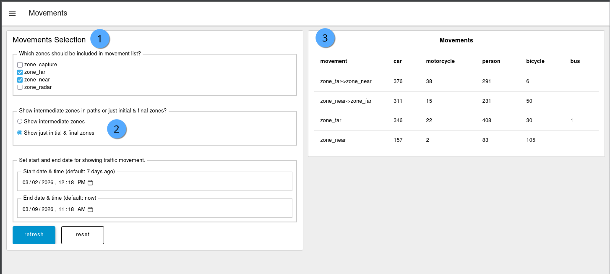
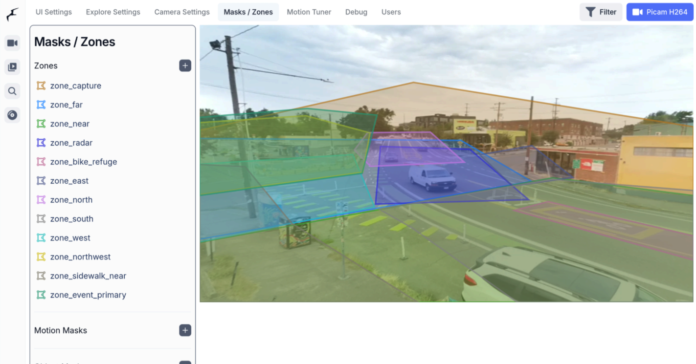
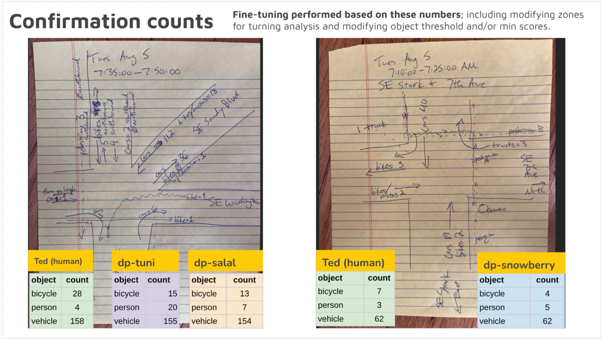

# Movements

Open `http://<device>/dashboard/movements`. Movements counts objects by the path they took through your zones, which is how you check the device against a manual count or confirm that the zones capture what you want.

Movements come from the `entered_zones` of each [event](../data-and-payloads/events-payload.md), so they depend on how the [zones](../setup-guide.md#3-adjust-the-zones) are drawn.

<figure markdown="span">
  
  <figcaption>The Movements page</figcaption>
</figure>

1. **Zones.** Tick the zones to include. The four standard `zone_*` zones are unticked by default, so that zones you drew for your own analysis stand out.
2. **Intermediate zones.** Choose **Show intermediate zones** to count each full sequence of zones separately, or **Show just initial & final zones** to group by where an object entered and where it left.
3. **Time range.** Start and end times; the last 7 days by default.
4. **Counts** by object type for each zone sequence that matches.

## Example: a complex intersection

An intersection with many zones has dozens of possible movements. Each turn or crossing becomes its own row, which you can compare with a manual count sheet.

<figure markdown="span">
  
  <figcaption>Twelve zones drawn on a busy five-way intersection</figcaption>
</figure>

<figure markdown="span">
  
  <figcaption>Manual confirmation counts; the left sheet matches the zones above</figcaption>
</figure>
