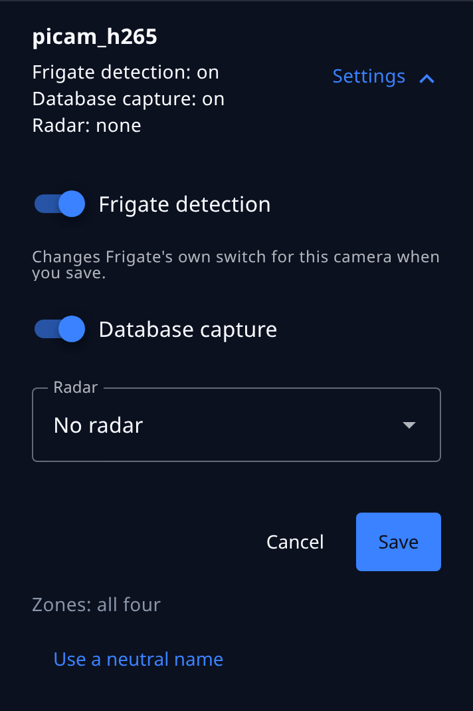
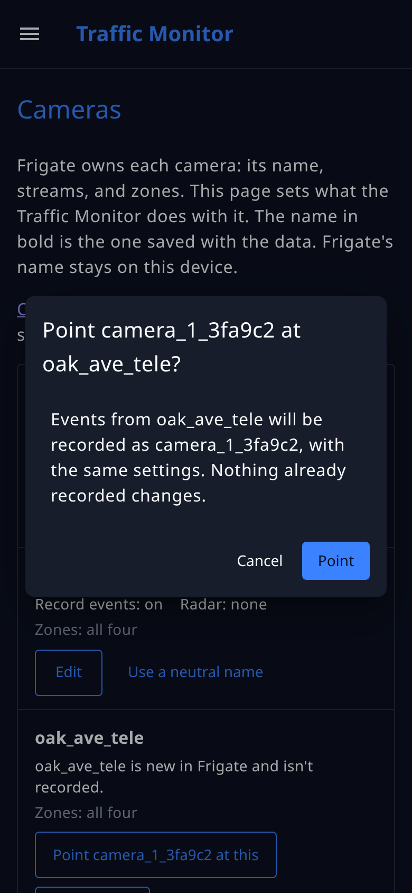

# Cameras

The control app's **Cameras** page connects each camera in [Frigate](../configuration/frigate-config.md) to its settings in the Traffic Monitor: whether its events are recorded, which radar gives it speeds, and whether its events go to [Plate Recognizer](../add-ons/plate-recognizer.md). It also keeps the two in step after you rename or add a camera in Frigate. Only the administrator sees the page.

A camera that was set up by the installer and never renamed works without it. Use the page when you rename a camera in Frigate, add one, pair a camera with a different radar, or want the camera's name kept out of the data the device saves and shares.

## Two names for each camera

Each camera has two names:

* **Frigate's name** is the one in Frigate's configuration, such as `oak_ave_wide`. Frigate uses it for the camera's streams, zones, and recordings, and for [Frigate+](../configuration/frigate-config.md#better-models). It can say where the camera is: an operator may name a camera after its street. It stays on the device.
* **The name in bold** on the Cameras page is the camera's entry in [`config.yml`](../configuration/node-red-config.md#sensorscameras). It's the name saved with every event and the name the device shares: in the database, in the MQTT messages `tm/event` and `tm/events`, in what a [server you share data with](sharing.md) receives, and in what Plate Recognizer receives.

For a new camera, the page makes the second name for you: `camera_` and a number, then six random characters from 0 to 9 and a to f, such as `camera_1_3fa9c2`. The number tells two cameras apart when you read the page. The random part keeps the name from being used twice on a device, so records from two different cameras never share a name. You can't type one yourself, because a typed name can hold a street again.

A device that has only `picam_h265`, as the installer sets it up, keeps working with no change: when an entry doesn't say which camera it is, it's the Frigate camera with the same name. `picam_h265` doesn't say where the device is, so you can leave it. To switch a camera with a name of your own to a neutral one, see [Use a neutral camera name](#use-a-neutral-camera-name).

## The Cameras page

**Cameras** is in the control app's menu, after **Detection**. At the top, the page says that Frigate owns each camera's name, streams, and zones, and links to Frigate for adding a camera or changing them. Then comes one row for each entry in `config.yml`, followed by one for each Frigate camera that no entry is paired with. Each row opens, one at a time, to show the camera's settings inside it. A Frigate camera that is turned off there and that no entry is paired with isn't listed: it sends no events. Turn it on in Frigate, and it appears.

{ width="300" }

An entry's row shows its name in bold, and Frigate's name beside it when the two differ. Under them are its settings and what Frigate has:

* **Frigate detection**: whether Frigate detects objects on the camera now. A camera turned off in Frigate detects nothing, so it reads off.
* **Database capture**: whether the Traffic Monitor saves the camera's events in its database and sends them on. An event is recorded only when both are on.
* **Radar**, and, when the Plate Recognizer add-on is installed, **Plates**.
* **Recommended zones present** and the four zones the [flows expect](../setup-guide.md#3-adjust-the-zones), or **Recommended zones missing in Frigate** and the ones the camera lacks, or **turned off in Frigate** and the ones that are there but switched off. Frigate can turn a zone off in its configuration or from its live view, and an object never enters a zone that is off, so it counts as missing for the Traffic Monitor.
* **Other zones enabled**: the camera's other zones that are on, by their IDs, with your name beside an ID that Frigate made up. Their IDs are saved with every event; see [Zone names are saved with your data](#zone-names-are-saved-with-your-data).
* **Off in Frigate**, when the camera is in Frigate's configuration but turned off there.

An entry whose camera is on in Frigate also has **Reference picture** on its row, while Frigate answers; see [Take a reference picture](#take-a-reference-picture).

A Frigate camera that no entry is paired with shows its **Frigate detection**, and **Database capture: off**.

### What needs attention

The page marks each problem the Status page's [camera checks](device-health.md#the-camera-checks) report, on the camera it's about, in the same colors: red for a problem, amber for a warning. Above the list, a line says how many cameras need attention. Each marked row has a box for each problem that says what's wrong and what to do on this page:

* Red: a camera **is new in Frigate and isn't recorded** while Frigate detects objects on it (point an entry at it, or add it), or another entry **already records this Frigate camera** (remove this one).
* Amber: **Frigate no longer has** the camera (point the entry at its new name, or remove it); the camera is turned off in Frigate, Frigate's detection is off, or **Database capture** is off, so its events **aren't recorded**; zones are missing or turned off, with a link, **Edit its zones in Frigate**, that opens Frigate's masks and zones settings at that camera; the camera's radar isn't turned on in `config.yml`; or a zone's name **looks like an address or a person's name**.

A grey note names the zones whose names have a word the Traffic Monitor doesn't recognize, and asks you to review them. It isn't a problem, and it doesn't count toward the line above the list.

A row with no box is in step. A new Frigate camera whose **Frigate detection** is off has no box either: nothing is detected, so nothing is dropped. You can still point an entry at it or add it. The page and the checks come from the same comparison, so they always agree.

When Frigate isn't answering, or has stopped itself in safe mode with no cameras, the page says so and can't compare. The settings stay editable, and the other buttons wait until Frigate answers.

## Change a camera's settings

Choose **Settings** on a camera's row. The row opens to its settings. Change them, and choose **Save**; **Cancel** closes the row without changing anything.

{ width="300" }

| Setting | What it does |
|---|---|
| **Frigate detection** | Frigate's own detection switch for this camera, the same one as in Frigate's live view. It changes when you save, without restarting Frigate, and Frigate keeps it after a restart. Off, Frigate stops detecting objects on the camera, so there are no events to record; it keeps streaming, and recording video if you set it to. Shown only while Frigate answers and the camera is on there. |
| **Database capture** | Off, the Traffic Monitor drops this camera's events: nothing is saved in the database or sent on. Frigate keeps detecting either way. |
| **Radar** | The radar that supplies this camera's speeds. The camera's direction needs an enabled radar too, whether it comes from the zones' order or from the radar. **No radar** records the camera's events with no speed and no direction. One radar can serve several cameras. |
| **Send plates to Plate Recognizer** | Shown only when the add-on is installed. See [Plate Recognizer](../add-ons/plate-recognizer.md). |

The drop-down lists the radars the device was installed with, each with its state:

* **off in config.yml**: the radar's entry has `enabled: false`, so it reads nothing.
* **port closed**: Node-RED hasn't opened the radar's serial port, for example because the radar was plugged in after the install. A radar that is off in `config.yml` shows both marks. See [First-time setup](../setup-guide.md#5-check-the-counts).
* **not set up in config.yml**: the radar has no entry under `sensors.radars`, so it can't be chosen. Pairing a camera with it would record no speeds.
* **missing**: the camera's current radar isn't one of the device's radars. Choose another, or **No radar**.

Radar settings themselves, such as turning a radar off, stay in [`config.yml`](../configuration/node-red-config.md#sensorsradars). Which way a sensor faces is set on the [Location page](location.md).

## After renaming a camera in Frigate

When you rename a camera in Frigate, the Traffic Monitor doesn't know the new name belongs to the same camera, and records nothing from it until you say so.

1. In Frigate's configuration editor, rename the camera and choose **Save & Restart**. Frigate uses the new name only after it restarts, so **Save** alone changes nothing yet.
2. Open the Cameras page. The old entry reads **Frigate no longer has** the old name, and the new name has its own row, **new in Frigate and isn't recorded**. If Frigate's detection is off for the camera, the new row has no box, because nothing is being dropped, but it still offers **Point**. If the old entry's **Database capture** is off too, it has no box either, because nothing was being recorded from it, and the new row still offers **Point**.
3. On the new row, choose **Point `<entry>` at this**, and confirm.

{ width="300" }

The entry keeps its name and settings, so the camera's records carry on under the same name, in the same deployment, with nothing changed in the database. If two cameras were renamed together, each new row offers a button for each entry whose camera is gone. To choose the right pair, look at the entries' rows: each shows Frigate's old name for its camera and its radar. An entry whose camera is only turned **Off** in Frigate isn't offered, because that camera still exists.

Until you point the entry at the new name, the Status page's **Cameras in config.yml** check is a problem. While Frigate's detection is off for the camera, it's a warning instead, about the old entry, whose camera is gone. If the entry's **Database capture** is off as well, the check passes, because nothing is being dropped. Pointing the entry at the new name doesn't turn **Database capture** on; do that in its settings if you want the camera recorded.

## Add a camera

A Frigate camera that no entry is paired with isn't recorded. On its row, choose **Add as new**. The row opens to the new entry's settings, with **Database capture** on, **No radar**, and plates off. Choose the radar, and **Add**. The page gives the entry its name.

## Use a neutral camera name

An entry whose name isn't of the form `camera_<number>_<six characters>` has **Use a neutral camera name** on its row. Choose it to switch the camera to a name the page makes, such as `camera_2_81d0e4`. The entry keeps its settings and its place in `config.yml`, and remembers the old name as Frigate's name, so the pairing doesn't change.

Records already saved keep the old name. They can't be renamed here, because rewriting a database of several gigabytes on a microSD card takes a long time. The dashboards' charts start again under the new name, and Node-RED ends the camera's deployment under the old name and starts one under the new one, at the same place and facing the same way. The confirmation says so before it does anything. A server that receives the device's data sees the old sensor end and a new one start.

## Remove an entry

An entry whose Frigate camera is gone, because you deleted the camera or renamed it and pointed no entry at the new name, has **Remove**. Choose it and confirm. The entry's settings are removed from `config.yml`, and Node-RED ends the camera's deployment. Records already saved are kept. The same button removes an entry that repeats another entry's Frigate camera.

## Take a reference picture

**Reference picture** gives you one zip for a tool that places recorded paths on a street: a still picture of what the camera sees, the same view with its zones marked, and the zones' shapes and sizes. Both pictures are the size of Frigate's detect frame, so paths and boxes recorded as fractions of that frame line up with them.

| File | What it holds |
|---|---|
| `<name>_clean.jpg` | The camera's current frame from Frigate, with nothing drawn on it |
| `<name>_zones.jpg` | The same view a moment later, drawn by Frigate with the outline of each zone that is on, in the zone's colour |
| `<name>.json` | The data file: the place, the camera, when the pictures were taken, and every zone; see [The data file](#the-data-file) |
| `<name>_zones.svg` | A drawing made by the control app: the clean picture with each zone outlined and named, and a legend below it |

The four files share one name, such as `tm-reference_3f9a1c2e-si_camera_1_3fa9c2_20261118T183005Z`: the ID of the place in use (`no-place` when there is none), the camera's name (the one in bold on its row), and when the clean picture was taken, in UTC.

1. On the camera's row, choose **Reference picture**. The dialog says what the picture gives away before any picture is taken.
2. Wait until nobody is in view, and choose **Take the pictures**. The dialog shows both pictures and the camera's zones with their colours and side lengths.
3. Look at both pictures. The device doesn't check them for people, so this is up to you. If anyone is in them, wait, and choose **Take again**.
4. Leave **Include this place's exact location** ticked to put the place's location in the data file, or clear it.
5. Choose **Save the zip**.

{ width="300" }

On a phone joined to the unit's hotspot, the pictures show in Android's sign-in window but the zip doesn't save there, the same as [Download diagnostics](wifi-hotspot.md#phones). Save it from a computer on the unit's network instead.

### What the picture gives away

The dialog opens with this note:

> This picture shows your street. Anyone who has it can tell where the unit is, and it shows whoever was in view. The device doesn't check the pictures for people. You are responsible for making sure nobody is in either picture before you save them: look at both, and if anyone is in them, wait and take them again. Share them only with people you would give the unit's exact location. The data file also holds that location unless you clear the box below.

* The location in the data file is the place's exact location, as set on the [Location page](location.md), not the rounded one the database keeps. When the place in use has no location, the box is greyed and the data file holds none.
* The device holds the pictures in memory for 10 minutes, for the administrator who took them, and never saves them. Closing the dialog, taking them again, or restarting the control app drops them sooner. They're never in the database, the exports, the diagnostics file, or anything the device uploads.
* The audit log records each picture taken and each zip saved, with the camera's name and whether the location was included, never the location itself.

### When it can't take the pictures

* **This camera is turned off in Frigate.** Turn it on in Frigate first.
* **Frigate has no live picture from this camera right now.** The camera isn't sending, or Frigate has only an older frame. Check the camera on the [Status page](device-health.md#the-status-page), then try again.
* **These pictures are no longer held on the device.** Ten minutes have passed, you took another picture, or the control app restarted. Take them again.

### The two drawings

The zones picture is Frigate's own drawing: outlines only, of the zones that are on, with no names. The SVG is the control app's, drawn on the clean picture from the data file. It outlines each zone that is on in its colour and names it, and letters the corners of each zone with side lengths (or, when no zone has any, of each zone with four corners). Its legend lists every zone, with its side lengths, or **off in Frigate, not drawn**, or **no outline** for a zone with fewer than three corners.

### The data file

| Field | What it holds |
|---|---|
| `format`, `format_version` | `traffic-monitor-reference` and `1` |
| `survey_id` | The ID of the place in use, or `null` |
| `camera` | The camera's name (the one in bold on its row) |
| `deployment_id` | The camera's open deployment at the place, or `null` |
| `location` | `{"lat": …, "lon": …}`, the place's exact location, or `null` when the box was cleared or there was no location to include |
| `pictures` | Each file's name, and for the two pictures `taken_at`, in UTC, such as `2026-11-18T18:30:05Z` |
| `traffic_monitor_version`, `frigate_version` | The versions running when the pictures were taken |
| `detect` | The `width` and `height` of Frigate's detect frame in pixels, which is the pictures' size |
| `distance_unit` | The unit of the zones' side lengths: `ft` when Frigate's interface is set to imperial units, else `m` |
| `zones` | Every zone of the camera, in Frigate's order, with the fields below |

| Zone field | What it holds |
|---|---|
| `key` | The zone's ID |
| `color` | The colour Frigate draws the zone in, as `#rrggbb`, or `null` |
| `enabled` | Whether the zone is on in Frigate |
| `drawn` | Whether the zone is outlined in the pictures: it's on and has at least three corners |
| `corners` | Each corner's `letter` (A, B, C, and on, in the order Frigate stores the corners) and its `x` and `y` as fractions of the frame's width and height, from the top-left corner, even where Frigate's configuration holds the zone in pixels. A corner past the frame's edge is below 0 or above 1 |
| `distances` | The side lengths entered in Frigate for speed estimation, in Frigate's order, or `[]` |
| `sides` | The same lengths by side, in the order Frigate stores the corners, such as `{"start": "A", "end": "B", "length": 12}`; the last side ends at A. `[]` unless there is one length for each corner |
| `inertia`, `loitering_time`, `speed_threshold`, `objects` | The zone's settings in Frigate |
| `filters` | For each object with filters in the zone, the ones that are numbers among `min_area`, `max_area`, `min_ratio`, `max_ratio`, `threshold`, and `min_score`. Any other filter is left out |

The names you typed for zones in Frigate's editor and the place's description are never in the data file or the drawing. Frigate's name for the camera isn't either, unless the camera's entry uses it as its own name, as the installer's `picam_h265` does: then it's in the files' names, the data file, and the drawing. To keep it out, [use a neutral camera name](#use-a-neutral-camera-name) first.

## Zone names are saved with your data

A zone's ID is saved with every event that enters it: in the database, in the exports, and in what the device uploads. Frigate makes the ID from the name you type in its zone editor, in lower case with `_` for spaces, so `1420 Oak St` is saved as `1420_oak_st`. Name zones for what they are, such as a compass direction (`zone_north`) or a lane (`zone_lane_bus`), not for a street, a house number, or a person.

A name with other punctuation, or with letters outside a to z, gets an ID that Frigate makes up, such as `zone_a9bacc03`. The page shows your name beside that ID and doesn't check it, because the ID says nothing about the place.

The page checks the IDs of each camera's other zones that are on:

* On a camera whose events are recorded, an amber box names the zones whose names look like an address or a person's name: a number of three or more digits, an apostrophe, a street abbreviation such as `st` or `ave`, or a street word such as `lane` or `strasse` together with an ordinal such as `5th` or a word the check doesn't recognize. The Status page's **Zone names** check warns too.
* A grey note names the zones whose names have a word the check doesn't recognize. The check knows about 200 English words for parts of a road, directions, and what moves on it, and can't tell whether another word is a street's name or a person's. A word in another language written in a to z, such as `nord`, gets the note too, so review the names and leave them if they're fine.

To rename a zone, choose **Edit its zones in Frigate** and change its name there. Its ID follows the new name. While the zone is on one of the camera's required-zones lists in Frigate (for reviews, snapshots, MQTT, and a few others), or a Frigate profile changes it, Frigate keeps its ID and changes only its name, and the page goes on showing the old ID: take the zone off those lists, rename it, then add it back under its new ID. Events already saved keep the old ID. The page never changes a zone itself.

## What still carries Frigate's name

The Traffic Monitor keeps Frigate's name out of what it saves and shares. These places still carry the name:

* **Frigate's own database, and its recordings and snapshots.** Frigate keeps events under its own camera names.
* **Frigate's `frigate/events` messages** on the device's [MQTT broker](../data-and-payloads/integrations.md). Anything subscribed to the broker sees them. Frigate publishes them, not the Traffic Monitor.
* **Frigate+.** The name identifies the camera for the scene conditions and annotations you submit.
* **A reference picture of an entry named for its Frigate camera.** The files' names, the data file, and the drawing carry the entry's name, which is then Frigate's name too. See [Take a reference picture](#take-a-reference-picture).
* **Records saved before a switch.** A device whose entry was named by hand has saved that name with its records, and keeps it there after you [use a neutral camera name](#use-a-neutral-camera-name).

The Status page shows Frigate's camera names to anyone who is logged in, as Frigate does. The [diagnostics file](device-health.md#download-diagnostics) replaces them before you send it to someone; that section lists its limits.

To change the entries by hand, see [`sensors.cameras`](../configuration/node-red-config.md#sensorscameras).
