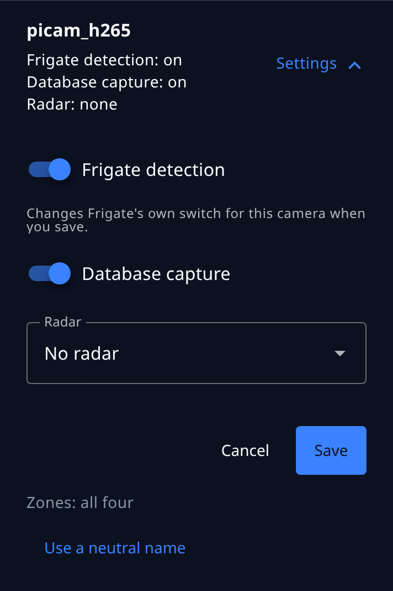
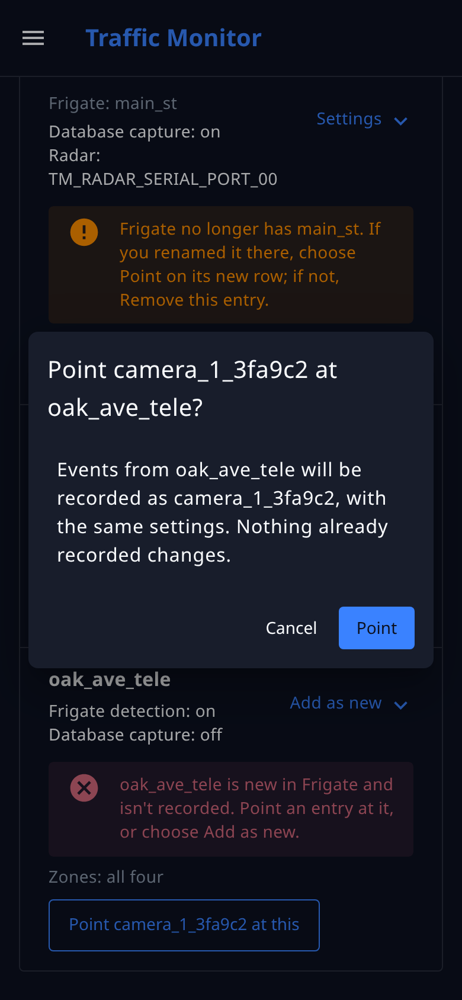

# Cameras

The control app's **Cameras** page connects each camera in [Frigate](../configuration/frigate-config.md) to its settings in the Traffic Monitor: whether its events are recorded, which radar gives it speeds, and whether its events go to [Plate Recognizer](../add-ons/plate-recognizer.md). It also keeps the two in step after you rename or add a camera in Frigate. Only the administrator sees the page.

A camera that was set up by the installer and never renamed works without it. Use the page when you rename a camera in Frigate, add one, pair a camera with a different radar, or want the camera's name kept out of the data the device saves and shares.

## Two names for each camera

Each camera has two names:

* **Frigate's name** is the one in Frigate's configuration, such as `oak_ave_wide`. Frigate uses it for the camera's streams, zones, and recordings, and for [Frigate+](../configuration/frigate-config.md#better-models). It can say where the camera is: an operator may name a camera after its street. It stays on the device.
* **The name in bold** on the Cameras page is the camera's entry in [`config.yml`](../configuration/node-red-config.md#sensorscameras). It's the name saved with every event and the name the device shares: in the database, in the MQTT messages `tm/event` and `tm/events`, in what a [ThingsBoard](../data-and-payloads/integrations.md) server receives, and in what Plate Recognizer receives.

For a new camera, the page makes the second name for you: `camera_` and a number, then six random characters from 0 to 9 and a to f, such as `camera_1_3fa9c2`. The number tells two cameras apart when you read the page. The random part keeps the name from being used twice on a device, so records from two different cameras never share a name. You can't type one yourself, because a typed name can hold a street again.

A device that has only `picam_h265`, as the installer sets it up, keeps working with no change: when an entry doesn't say which camera it is, it's the Frigate camera with the same name. `picam_h265` doesn't say where the device is, so you can leave it. To switch a camera with a name of your own to a neutral one, see [Use a neutral name](#use-a-neutral-name).

## The Cameras page

**Cameras** is in the control app's menu, after **Detection**. At the top, the page says that Frigate owns each camera's name, streams, and zones, and links to Frigate for adding a camera or changing them. Then comes one row for each entry in `config.yml`, followed by one for each Frigate camera that no entry is paired with. Each row opens, one at a time, to show the camera's settings inside it. A Frigate camera that is turned off there and that no entry is paired with isn't listed: it sends no events. Turn it on in Frigate, and it appears.

{ width="300" }

An entry's row shows its name in bold, and Frigate's name beside it when the two differ. Under them are its settings and what Frigate has:

* **Frigate detection**: whether Frigate detects objects on the camera now. A camera turned off in Frigate detects nothing, so it reads off.
* **Database capture**: whether the Traffic Monitor saves the camera's events in its database and sends them on. An event is recorded only when both are on.
* **Radar**, and, when the Plate Recognizer add-on is installed, **Plates**.
* **Zones: all four**, or **Missing in Frigate** and the zones the [flows expect](../setup-guide.md#3-adjust-the-zones) that the camera lacks, or **Turned off in Frigate** and the ones that are there but switched off. Frigate can turn a zone off in its configuration or from its live view, and an object never enters a zone that is off, so it counts as missing for the Traffic Monitor.
* **Off in Frigate**, when the camera is in Frigate's configuration but turned off there.

A Frigate camera that no entry is paired with shows its **Frigate detection**, and **Database capture: off**.

### What needs attention

The page marks each problem the Status page's [camera checks](device-health.md#the-camera-checks) report, on the camera it's about, in the same colors: red for a problem, amber for a warning. Above the list, a line says how many cameras need attention. Each marked row has a box for each problem that says what's wrong and what to do on this page:

* Red: a camera **is new in Frigate and isn't recorded** (point an entry at it, or add it), or another entry **already records this Frigate camera** (remove this one).
* Amber: **Frigate no longer has** the camera (point the entry at its new name, or remove it); the camera is turned off in Frigate, Frigate's detection is off, or **Database capture** is off, so its events **aren't recorded**; zones are missing or turned off, with a link, **Edit its zones in Frigate**, that opens Frigate's masks and zones settings at that camera; or the camera's radar isn't turned on in `config.yml`.

A row with no box is in step. The page and the checks come from the same comparison, so they always agree.

When Frigate isn't answering, or has stopped itself in safe mode with no cameras, the page says so and can't compare. The settings stay editable, and the other buttons wait until Frigate answers.

## Change a camera's settings

Choose **Settings** on a camera's row. The row opens to its settings. Change them, and choose **Save**; **Cancel** closes the row without changing anything.

{ width="300" }

| Setting | What it does |
|---|---|
| **Frigate detection** | Frigate's own detection switch for this camera, the same one as in Frigate's live view. It changes when you save, without restarting Frigate, and Frigate keeps it after a restart. Off, Frigate stops detecting objects on the camera, so there are no events to record; it keeps streaming, and recording video if you set it to. Shown only while Frigate answers and the camera is on there. |
| **Database capture** | Off, the Traffic Monitor drops this camera's events: nothing is saved in the database or sent on. Frigate keeps detecting either way. |
| **Radar** | The radar that supplies this camera's speeds. The camera's direction needs an enabled radar too, whether it comes from the zones' order or from the radar. **No radar** records the camera's events with no speed and no direction. One radar can serve several cameras. |
| **Send plates to Plate Recognizer** | Shown only when the add-on is installed. See [Plate Recognizer](../add-ons/plate-recognizer.md). |

The drop-down lists the radars the device was installed with, each with its state:

* **off in config.yml**: the radar's entry has `enabled: false`, so it reads nothing.
* **port closed**: Node-RED hasn't opened the radar's serial port, for example because the radar was plugged in after the install. A radar that is off in `config.yml` shows both marks. See [First-time setup](../setup-guide.md#5-check-the-counts).
* **not set up in config.yml**: the radar has no entry under `sensors.radars`, so it can't be chosen. Pairing a camera with it would record no speeds.
* **missing**: the camera's current radar isn't one of the device's radars. Choose another, or **No radar**.

Radar settings themselves, such as turning a radar off, stay in [`config.yml`](../configuration/node-red-config.md#sensorsradars). Which way a sensor faces is set on the [Location page](location.md).

## After renaming a camera in Frigate

When you rename a camera in Frigate, the Traffic Monitor doesn't know the new name belongs to the same camera, and records nothing from it until you say so.

1. In Frigate's configuration editor, rename the camera and choose **Save & Restart**. Frigate uses the new name only after it restarts, so **Save** alone changes nothing yet.
2. Open the Cameras page. The old entry reads **Frigate no longer has** the old name, and the new name has its own row, **new in Frigate and isn't recorded**.
3. On the new row, choose **Point `<entry>` at this**, and confirm.

{ width="300" }

The entry keeps its name and settings, so the camera's records carry on under the same name, in the same deployment, with nothing changed in the database. If two cameras were renamed together, each new row offers a button for each entry whose camera is gone. To choose the right pair, look at the entries' rows: each shows Frigate's old name for its camera and its radar. An entry whose camera is only turned **Off** in Frigate isn't offered, because that camera still exists.

Until you point the entry at the new name, the Status page's **Cameras in config.yml** check is a problem.

## Add a camera

A Frigate camera that no entry is paired with isn't recorded. On its row, choose **Add as new**. The row opens to the new entry's settings, with **Database capture** on, **No radar**, and plates off. Choose the radar, and **Add**. The page gives the entry its name.

## Use a neutral name

An entry whose name isn't of the form `camera_<number>_<six characters>` has **Use a neutral name** on its row. Choose it to switch the camera to a name the page makes, such as `camera_2_81d0e4`. The entry keeps its settings and its place in `config.yml`, and remembers the old name as Frigate's name, so the pairing doesn't change.

Records already saved keep the old name. They can't be renamed here, because rewriting a database of several gigabytes on a microSD card takes a long time. The dashboards' charts start again under the new name, and Node-RED ends the camera's deployment under the old name and starts one under the new one, at the same place and facing the same way. The confirmation says so before it does anything. A server that receives the device's data sees the old sensor end and a new one start.

## Remove an entry

An entry whose Frigate camera is gone, because you deleted the camera or renamed it and pointed no entry at the new name, has **Remove**. Choose it and confirm. The entry's settings are removed from `config.yml`, and Node-RED ends the camera's deployment. Records already saved are kept. The same button removes an entry that repeats another entry's Frigate camera.

## What still carries Frigate's name

The Traffic Monitor keeps Frigate's name out of what it saves and shares. These places are Frigate's own, or hold the device's settings as they are, and still carry the name:

* **Frigate's own database, and its recordings and snapshots.** Frigate keeps events under its own camera names.
* **Frigate's `frigate/events` messages** on the device's [MQTT broker](../data-and-payloads/integrations.md). Anything subscribed to the broker sees them. Frigate publishes them, not the Traffic Monitor.
* **Frigate+.** The name identifies the camera for the scene conditions and annotations you submit.
* **The Backup button.** With ThingsBoard connected, the **Backup & Restore** section of the legacy dashboard uploads Frigate's whole configuration, camera names included, when you press it. The copy of `config.yml` that goes to ThingsBoard leaves out each entry's `frigate_camera` setting.
* **Records saved before a switch.** A device whose entry was named by hand has saved that name with its records, and keeps it there after you [use a neutral name](#use-a-neutral-name).

The Status page shows Frigate's camera names to anyone who is logged in, as Frigate does. The [diagnostics file](device-health.md#download-diagnostics) replaces them before you send it to someone; that section lists its limits.

To change the entries by hand, see [`sensors.cameras`](../configuration/node-red-config.md#sensorscameras).
