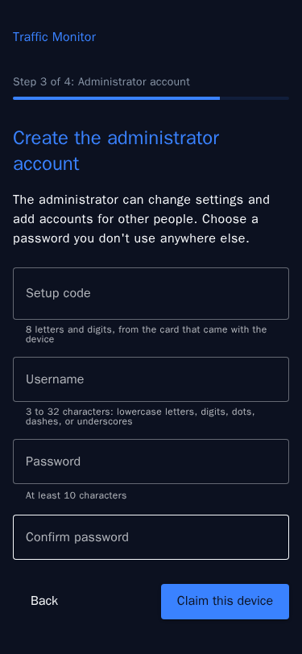

# Control app and login

The device's [home page](home-page.md) is its control app. It holds the device's accounts, and one login there opens every app on the device: the dashboards, Frigate, the Node-RED editor, the camera feeds, and Cockpit. These accounts belong to the device. They're separate from the Raspberry Pi user account you created when you imaged the card, which the control app calls the **system password**.

!!! info "What the login protects"

    The login keeps people on your network out of the apps. The device uses plain HTTP, so passwords and images cross your network unencrypted. Use the device on a network you trust.

## Claim the device

A device that has no administrator yet sends every page to setup. That happens on a new device, after an update from a version without the login, and after [`reset-admin`](#if-the-administrators-password-is-lost). Setup has four steps: a welcome page, the license agreement, the administrator account, and the system password.

You need the **setup code**, eight letters and digits written as `XXXX-XXXX`. It comes from one of two places:

* **A pre-built unit:** the card that came with the device.
* **A device you installed yourself:** the end of the installer's output, in a line like this one:

    ```text
    This device isn't claimed yet. Open http://tm-01.local/ (or its IP address) and enter the setup code ABCD-EFGH
    to create the administrator account. The code works once.
    ```

    The installer prints the same code on every run until the device is claimed. Its log in your home folder (`~/tmsetup-<date>-<time>.log`) has the same output; keep the log on the device. On the device, `sudo cat /etc/traffic-monitor/setup-code` also shows the code.

To claim the device:

1. Open `http://<device>/`. [Home page and apps](home-page.md) explains how to find the address.
2. Choose **Start setup**, read the license agreement, and accept it.
3. Enter the setup code, then a username and password for the administrator account. Usernames are 3 to 32 characters: lowercase letters, digits, dots, dashes, and underscores. Passwords are at least 10 characters.
4. Choose **Claim this device**. You're logged in as the administrator.
5. Set a new [system password](#the-system-password), or choose **Skip for now**.

<figure markdown="span">
  { width="300" }
  <figcaption>Step 3 of setup creates the administrator account</figcaption>
</figure>

The code works once. After several wrong codes, setup makes you wait before the next try, a little longer after each wrong code.

??? note "When the license agreement changes"

    An update can bring a new version of the license agreement. Until the administrator accepts it, nobody can open the apps. The administrator sees the new version after logging in. Viewers see **Waiting for an administrator** until it's accepted.

## The system password

The system password is the password of the Raspberry Pi user account: the one you log in to Cockpit and SSH with. Setup offers to change it, with a **Use the same password as my account** checkbox. Skip the step to keep the password the account has. To change it later, use Cockpit's **Accounts** page, or run `passwd` over SSH.

## Log in

Open the home page or any app. Without a session, the device shows its login page, then takes you to the page you asked for. You stay logged in for a week, and using the device keeps the session going. To log out, choose **Log out** in the menu. Frigate's own **Logout** also logs you out of the device.

After five wrong passwords in a row, the device makes you wait before the next try: a few seconds at first, and twice as long after each further wrong password, up to 5 minutes. It counts wrong passwords for the account and for the address they come from, so a wait for an account applies on every phone and computer. Sessions that are already logged in keep working. The count clears 15 minutes after the last wrong password, or when the login succeeds.

## Administrators and viewers

Each device has one administrator, the account created when it was claimed, and any number of viewers.

| App or page | Administrator | Viewer |
|---|---|---|
| Dashboard and Legacy Dashboard | Yes | Yes |
| Downloads on the [Data export](../ui/database.md) page | Yes | No |
| Frigate: live view, review, and explore | Yes | Yes |
| Frigate: settings and the configuration editor | Yes | No |
| Node-RED editor, Camera feeds, and Cockpit | Yes | No |
| The **Users** page | Yes | No |

### Add a viewer

1. Open **Users** from the menu.
2. Under **Add a viewer**, enter a username and a password, and choose **Add viewer**.
3. Give the person the username and password.

Each viewer's menu on the **Users** page has **Set a new password**, which also logs them out everywhere, and **Remove**.

## Change your password

Open **Account** from the menu. Under **Change your password**, enter your current password and the new one. Every other browser and phone where you were logged in is logged out; this one stays logged in. Wrong current passwords count toward the same wait as wrong logins.

**Log out everywhere**, on the same page, ends your sessions in every browser and on every phone, including the one you're using. Use it if you logged in on a device that isn't yours.

## If you forget a password

* **A viewer's password:** the administrator sets a new one on the **Users** page.
* **The administrator's password:** see the next section.

### If the administrator's password is lost

Someone who can log in to the device with the Raspberry Pi user account can start over. Open a terminal over SSH, or in Cockpit at `http://<device>:9090`, and run:

```bash
sudo tm-control reset-admin
```

It removes every account, the administrator and all viewers, and prints a new setup code. Then [claim the device](#claim-the-device) again with that code. Your data and settings stay as they are.

## If the control app is down

When the control app doesn't answer, the apps can't check your login. Every app then shows a page that says the control app isn't answering, and the home page says **The control app isn't answering**. To start it again:

* In a browser, open Cockpit at `http://<device>:9090`. It doesn't need the control app. Log in with your Raspberry Pi user account, go to **Services**, open `tm-control.service`, and restart it.
* Over SSH, run:

    ```bash
    sudo systemctl restart tm-control.service
    sudo journalctl -u tm-control.service -n 50   # if it stops again, the reason is in its log
    ```

An app that's down while the control app works, such as Frigate during a restart, shows a `502 Bad Gateway` error instead. [System administration](system-admin.md) covers the services and their logs.
