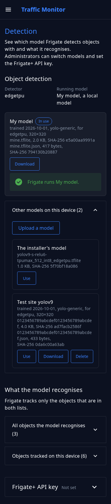
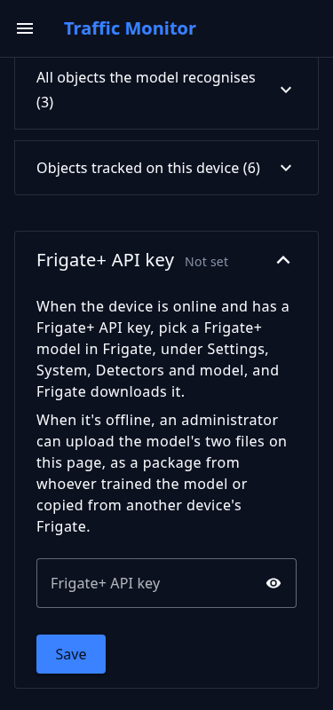

# Choose the detection model

The control app's **Detection** page shows what the device looks for and which AI model does the looking, and lets the administrator change the model without SSH. [Frigate](../configuration/frigate-config.md) runs the model on the device's detector: a Coral or Hailo accelerator, or the processor when there's none. To get a better model for a difficult site, see [Better models](../configuration/frigate-config.md#better-models).

## The Detection page

**Detection** is in the control app's menu, after **Device**. The page opens with a line on what it's for, then two facts: the **Detector**, such as `edgetpu` for a Coral, and the **Running model**. Below them is the model Frigate runs, marked **In use**. The device's other models are under **Other models on this device**, which stays closed until you select its title, and the title counts them. Then come [what the model recognises](#what-the-model-recognises) and the [Frigate+ API key](#frigate-plus).

{ width="300" }

Each model shows its name, when it was trained and what it's built for (when it says), and its files with their sizes and the start of each file's SHA-256 hash. A mark says when the model is:

| Mark | Meaning |
|---|---|
| In use | Frigate runs this model. |
| can't run on this detector | The model is built for another detector than the device's, so **Use** is off. |
| incomplete | The model has its file but not its `.json`, or the other way round. |

The model the installer set up is shown as **The installer's model**. It has no `.json`, and it can't be downloaded or deleted. A device without a Coral has no installer's model: Frigate then runs its own built-in model until you choose another, and the page shows it as **Frigate's built-in model**, which can't be downloaded or deleted either.

Everyone who can log in sees the models, the label lists, and the Frigate+ text. Administrators also get **Upload a model**, the first thing under **Other models on this device**, then **Use**, **Download**, and **Delete** on each model, and the Frigate+ API key. While Frigate runs another model, the device's default (the installer's model, or Frigate's built-in model on a device without a Coral) has a **Use** of its own.

When Frigate isn't answering, the page says so and shows what Frigate's config file says. The same when Frigate started in safe mode because it couldn't use its config: the page says so, nothing is detected meanwhile, and **Use** on a model, or on the installer's model, gives Frigate a config it can run.

## Upload a model

A model is a model file and a small `.json` file beside it, its *sidecar*, which tells Frigate how to use it. Choose **Upload a model** under **Other models on this device**, then pick one of these:

* **A package** from whoever trained the model: a zip or tar.gz with the model file and its `.json` at the top level, not inside a folder. A zip must be stored or deflate-compressed, which is what ordinary zip tools make. If the package has a `SHA256SUMS` file, the device checks the files against it.
* **The two files**, the model file and its `.json`. The `.json` must be named for the model file: `mine.tflite` and `mine.tflite.json`. The page sends the `.json` first.
* **A model file alone.** The page then asks for what Frigate needs to know about it and writes the `.json` for you. The settings are a name for the model list (the file name when left empty), the model type, the width and height of its input, the input tensor, the pixel format, optionally the input data type, and the labels, one per line in the model's order. On a device with a Coral or Hailo accelerator, the fields start with Frigate's example for that detector. The values come from the model's documentation; Frigate's [reference config](https://docs.frigate.video/configuration/advanced/reference) lists what each setting accepts.
* **A `.json` alone**, to finish a model file that's on the device already.

The page shows every file when you pick, because a Frigate+ model's file has no extension.

The limits are 100 MB for a model file, 2 MB for a `.json`, and at least 512 MB of free storage left afterwards. A model whose name is already on the device is refused; delete the old one first. A model file can't be named `default`, which the page keeps for the device's default. A model has to be built for the device's detector. The page marks one that isn't, and won't use it.

!!! warning "Take models only from a source you trust"

    A model is code that the detector runs. A model from an unknown source can make the device count wrongly or fail. Upload only models you trained, or that come from a source you trust.

## Use a model

Choose **Use** on a model and confirm. Frigate checks the whole configuration with the model in it and saves it, and then the device restarts Frigate. A restart takes about a minute, and the device counts nothing meanwhile. The page asks every few seconds and says when Frigate runs the model. If Frigate hasn't come back after 90 seconds, the page says so and links to the [Status page](device-health.md#the-status-page).

If Frigate refuses the change, the page shows Frigate's reason, and nothing changes. When Frigate isn't answering at all, the device edits Frigate's `config.yml` itself, keeps a backup beside it, and restarts Frigate. That's how **Use** on **The installer's model** gets a device out of a bad choice without SSH. On a device without a Coral, **Use** on **Frigate's built-in model** does the same.

The page refuses a **Use** in these cases:

* Frigate is restarting. Try again in a minute.
* The device's detector can't be told, because Frigate isn't answering and its config file can't be read, so the model can't be checked against it.
* Frigate's config sets a model inside a detector, which would override this one. Remove that model in Frigate's config editor first.
* The installer's model file is gone from the device.

## Download a model

**Download** saves a zip with the model's file, its `.json`, and a `SHA256SUMS` file. The files are byte for byte what's on the device, so the zip is a backup, or a way to put the same model on another device with **Upload a model**. A `.json` keeps every field it came with, including ones the page doesn't show.

## Delete a model

**Delete** asks first, then removes both of the model's files. It can't remove the model Frigate runs, the installer's model, or Frigate's built-in model. To delete the model that's running, use another model first, such as **The installer's model**.

## What the model recognises

The page lists two sets of objects. Each is closed until you select its title, which counts the objects, and each has a **Copy** button:

* **All objects the model recognises** is what the running model can detect, read from Frigate when it answers.
* **Objects tracked on this device** is the objects Frigate is set to track, from its `objects:` `track` lists.

Frigate tracks only the objects in both lists. To track more of what the model recognises, change the lists in Frigate's configuration editor; see [Tune object detection](../configuration/frigate-config.md).

## Frigate+ { #frigate-plus }

[Frigate+](../configuration/frigate-config.md#better-models) trains models on snapshots from your device. There are two ways to get one onto it:

* **Online:** when the device has internet and a Frigate+ API key, pick the model in Frigate, under **Settings > System > Detectors and model**, and Frigate downloads it. Then choose [Use](#use-a-model) here if Frigate doesn't run it already.
* **Offline:** upload the model's two files on this page, as a package from whoever trained the model, or copied from another device's Frigate. See [A device without internet](../configuration/frigate-config.md#a-device-without-internet).

{ width="300" }

Administrators enter the API key under **Frigate+ API key**, the last section of the page, which is closed until you select its title. The Status page's **Set the key** opens it. The key is kept with the device's other secrets, not in `config.yml`.

* The page never shows the key back. The section's title says whether the key is set, its last four characters for a key of 12 or more characters, and "in use" while Frigate runs a Frigate+ model.
* **Save** stores what you typed. A key is 36 characters, a colon, and 40 lowercase letters or digits, as Frigate+ shows it; the page refuses anything else. The eye icon shows the key while you type.
* **Remove** asks first, then empties the key. Without a key, snapshots can't be submitted to Frigate+. A Frigate+ model whose files are on the device keeps running; one that isn't downloaded yet [stops Frigate](../configuration/frigate-config.md#if-frigate-stops-over-a-model) until the key is set again, and the Status page's Frigate+ check says so.
* Saving or removing restarts Frigate, which takes about a minute. The device counts nothing meanwhile.

The ThingsBoard and Plate Recognizer keys are on the [Device page](device-health.md#tokens-and-keys).
