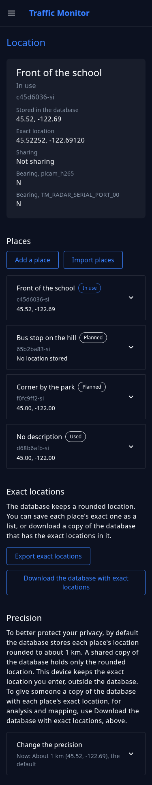
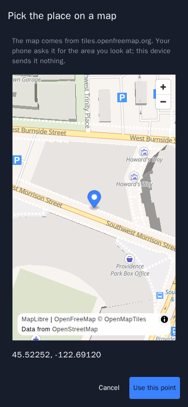
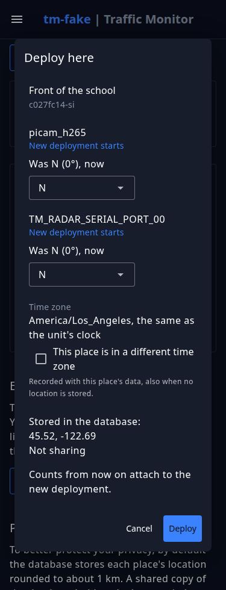
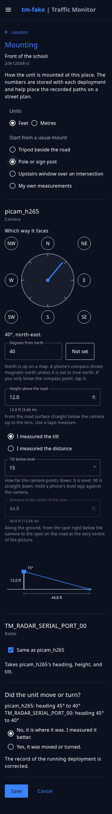

# Places and location

The control app's **Location** page records where the device is and which way its sensors face, and its **Mounting** page records how each sensor is mounted. The Location page also sets how precisely the database stores the location. Only the administrator sees the page, because it shows exact coordinates. A device that stays in one place works without it, so use it when you move the device, turn it, or plan to share its data.

## Places and deployments

A *place* is somewhere the device has been, is, or will be. Each place has an id such as `3f9a1c2e-si`, an optional description that only you see, and an optional location, its latitude and longitude. A place doesn't need a location: a device with none still counts and records its data, only without saying where. One place can hold sensors that face different ways, such as a corner with a radar looking down each street.

One place is always **In use**. The others are **Planned**, entered ahead of a move, or **Used**, where the device has been. Claiming a new device creates its first place, **First location**, with no location.

Each sensor at a place, facing one way, for one stretch of time, is a *deployment*. Every count and reading is stored with its deployment, so you can tell where it was taken after the device moves. Moving to another place, or moving or turning a sensor, starts a new deployment, and the earlier ones keep what they recorded.

The exact location is kept in the control app and in Node-RED's settings file, [`config.yml`](../configuration/node-red-config.md#deployment). The database stores the place's id and the location rounded to the [precision](#choose-the-precision) you choose.

## The Location page

**Location** is in the control app's menu, after **Cameras**. The card at the top shows the place in use: its description, its id, the location as the database stores it, the exact location, what the device [shares](sharing.md), and the way each sensor faces. When the place has [mounting values from the last time the unit was there](#a-place-used-before), the card says so and has a **Mounting** button. Then come the list of places, the [list of exact locations](#export-the-exact-locations), and, last, the [precision](#choose-the-precision). A copy of the database with the exact locations in it is on the [Sharing page](sharing.md#include-each-places-exact-location).

{ width="300" }

Each place in the list shows its description, or **No description**, its mark (**In use**, **Planned**, or **Used**), its id, and its location as the database stores it. Select a place to open it. An open place shows:

* **Imported from your previous settings** for a place that came from an older version's data; see [Update the software](../build-your-own-device-diy/update.md#places-after-an-update).
* When the place was first and last used, or **Not used yet**.
* How many events were recorded there, and between which dates.
* Its deployments, newest first, grouped by when they were deployed: the sensors started together sit under one date, each with what it recorded, such as **Facing NE (40°) · 7.0 ft up · tilted 15°**. A radar deployed with a camera is indented under it. A sensor that ended before the rest of its group says when. A deployment that has ended has **Correct heading**. One that is running at the place in use has **Mounting** instead, because that is where it is changed.
* The buttons for what you can do with the place: **Deploy here** for a planned place, **Re-deploy here** for a used one, or **Mounting** for the place in use; **Edit** for a planned place; **Correct location** for a used place or the place in use that has a location; and **Delete** for any place but the one in use.

**Before any place was recorded** counts the deployments that had already ended when the device got its first place. They belong to no place, and the database keeps them as they are. Deployments still running then joined that first place.

If Node-RED hasn't answered yet, as right after an update, a warning at the top says past places may be missing. Reload the page once Node-RED is running. Opening the control app's home page or Status page sets the places up too.

## Add a place

Choose **Add a place**, fill in what you know, and **Save**. The place is added as planned.

* **Description**: a name for the place, such as "Front of the school". It never leaves the device.
* **Coordinates**: the latitude and longitude, pasted from a maps app as one value, such as `45.52252, -122.69120`, or [picked on a map](#pick-the-point-on-a-map). Use a dot as the decimal mark. The device keeps five decimal places, about a metre. Use at least four, about 10 metres, for an exact location: with fewer, the form warns and says how coarse the point is (about 100 metres for three decimals, and coarser for fewer), and still saves it. Leave the field empty for a place with no location.
* **Facing**, for each sensor turned on in the settings: a compass point, `N`, `NE`, `E`, `SE`, `S`, `SW`, `W`, or `NW`, or **Not set**. See [Which way a sensor faces](#which-way-a-sensor-faces).

**Use this phone's location** fills in the coordinates from your phone's location. Browsers share a location only with pages opened over HTTPS, and the device uses plain HTTP, so the form usually says to paste coordinates instead.

### Pick the point on a map

Under the coordinates, **Pick on a map** opens a map. Tap the spot to place a pin, drag the pin to the exact place, and choose **Use this point**. The form fills in the coordinates with five decimal places, and you can still change them before you save. The same button is on **Correct location**.

{ width="300" }

The map is drawn by your phone or computer, not by the device. It opens at the coordinates in the field, else at the place in use, else over the region of the device's time zone: a wide view around that city, about the size of a time zone. The device finds the region from its own time zone, so it asks no one, and uses it only when its Wi-Fi country is set and is one of the countries that time zone covers. Otherwise it opens on the whole world. The installer sets the time zone (its `-z` option, `America/Los_Angeles` unless you give another), so a device left on the installer's time zone and Wi-Fi country opens over Los Angeles until you set its time zone on the [Date and time page](device-health.md#the-date-and-time-page). Your browser asks the map's server, named in the dialog, for the pictures of the area you look at, and the device sends it nothing. The server sees the map tiles that cover the area you look at, squares of roughly one to two kilometres across, even when you zoom in as far as the map goes. That includes the area of the place in use the moment the map opens, even when you are adding a place somewhere else. Opened over the region, the map asks for tiles that cover an area thousands of kilometres across, which says little more than your phone's internet address already does. As any website does, the server also sees your phone's internet address. It never gets the exact point you choose. If the map can't load, the dialog says so and offers **Try again**; type or paste the coordinates instead.

The map isn't offered while your phone is on the device's own [hotspot](wifi-hotspot.md#phones), because the hotspot has no internet. The form says so; paste the coordinates, or open the page once the device is on your Wi-Fi.

To get coordinates from a maps app on your phone, in Google Maps press and hold the spot, then copy the coordinates shown. In Apple Maps, drop a pin; its card shows the coordinates. The phone's GPS needs no internet connection, though the app's map may not draw without one.

To change a planned place, open it and choose **Edit**. A place that has been used can't be edited; [correct it](#correct-a-wrong-location-or-heading) instead.

## Which way a sensor faces

A sensor's *heading* is the way it faces, in whole degrees clockwise from true north, from 0 to 359: 0 is north, 90 is east, 180 is south, and 270 is west. The page shows it with the nearest compass point, such as **NE (40°)**. A point covers the 45 degrees around its centre, so 23 to 67 degrees is `NE`, and 338 to 359 and 0 to 22 is `N`.

The page lets you pick one of the eight points, which sets the heading to the point's centre, as the [table of centres](../configuration/node-red-config.md#if-your-file-still-says-bearing) lists. Nothing stores the point itself, only the number. A heading you measured more closely, such as 40 from a compass app, or typed into [`config.yml`](../configuration/node-red-config.md#deployment) or an [imported file](#import-places-from-a-file), is kept as it is and listed first in the choices as **NE (40°)**, so opening the choice and closing it changes nothing. Pick a point only to replace it. Until you save or close the form, the measured heading stays in the list, so you can choose it again if you picked a point by mistake.

Use true north, not magnetic north, because the two differ by several degrees in many places, and a phone's compass app can show either. A heading is optional. **Not set** records that you haven't said.

A device updated from an older release has its earlier headings converted; see [Headings after an update](../build-your-own-device-diy/update.md#headings-after-an-update).

## Move or turn the device

When the device moves to another place, record it from that place: **Deploy here** if the place is planned, or **Re-deploy here** if the device has been there before. When a sensor is moved or turned at the place in use, record it on the [Mounting page](#record-how-the-unit-is-mounted).

1. Open the place, and choose **Deploy here** or **Re-deploy here**.
2. Check the review. For each sensor, it says whether a new deployment starts, the way the sensor faced before, and the way it faces now, which you can change. Under the sensors are what the database will store for the place and whether the device shares its data.
3. Choose **Deploy** or **Re-deploy**.

{ width="300" }

The page waits while Node-RED starts the new deployments, then lists their ids, each with **Copy**. Counts from then on belong to the new deployments. Under the list is the next step, **Mounting**, which opens the page where you record how the unit is mounted. At a place the unit was at before, the values last saved there are offered, and the next step says so; **Use these values** and then **Save** confirm them. See [A place used before](#a-place-used-before).

!!! warning "Don't deploy twice"

    If Node-RED hasn't loaded the new settings within about 20 seconds, the page says the settings are saved and the deployments appear once Node-RED loads them. If the connection drops while the page waits, it says the settings may already be saved. In both cases, close the dialog and check the place in the list before you deploy again.

A deploy records none of a sensor's tilt, height, distance, or mount, at a place the unit was at before just as at a new one, because the unit was taken down and put up again. The sensors have none of the four until you record them on the Mounting page (see also [How a sensor is mounted](../configuration/node-red-config.md#how-a-sensor-is-mounted)). The heading is the one you choose in the review, which starts from the place's last one.

A move usually also needs the camera's zones adjusted; see [First-time setup](../setup-guide.md#3-adjust-the-zones).

## Record how the unit is mounted

The **Mounting** page records how each sensor is mounted at the place in use. Open it from the **Mounting** button in the place in use's panel in the list, from the **Mounting** link on a running deployment, from the button the deploy leaves, or from the card at the top while the place has [values from last time](#a-place-used-before) to confirm. Only the administrator sees it. It works on the unit's own [hotspot](wifi-hotspot.md), because it needs no internet.

{ width="300" }

The page says what the numbers are for: they are stored with each deployment and help place the recorded paths on a street plan. Under the title are the **Units**, **Feet** or **Metres**, and **Start from a usual mount**. Then comes a section for each sensor, with a camera first and its radar under it. If Node-RED doesn't answer, the page warns that changes can't be saved, and **Save** stays off.

Everything is optional. Record what you know, and leave the rest empty. Use **Save** when you are done: nothing is recorded until then, and **Cancel** goes back to the Location page.

### Feet and metres

**Feet** is the default. Each length is shown in the unit you chose, and under it in the other, such as **7.0 ft (2.13 m)**. The page remembers your choice in the browser. The device stores metres, rounded to two decimals, so a length typed in feet is stored as the nearest centimetre, and a length you don't touch, or type back to what it showed, is saved exactly as it was. A comma works as the decimal mark too, as in 7,5, but not before exactly three digits, as in 1,000. A field that holds something that isn't a number says **Enter a number, such as 12 or 12.5.**, and **Save** stays off until you fix it.

### Start from a usual mount

Picking a usual mount fills in a typical height and tilt for every camera and radar section, chooses **I measured the tilt**, and records the mount's name. It changes nothing else. Change the numbers afterwards to what you measured, or choose **My own measurements** to keep the numbers and drop the name of the mount. Nothing is saved until you choose **Save**. The three mounts are in [Usual mounts](../deployment-and-mounting-guide.md#usual-mounts).

### Which way it faces

Each sensor has a dial labelled **Which way it faces**. The heading is in whole degrees clockwise from true north, as in [Which way a sensor faces](#which-way-a-sensor-faces). Set it in any of these ways:

* Tap or drag on the ring. North is at the top. The needle follows your finger, and a drag may leave the ring. Pressing the very centre changes nothing.
* Tap one of the eight compass points around the ring, which sets the heading to the point's centre. This is fine when the point is all you know.
* Type a number in **Degrees from north**. A number that isn't a whole number from 0 to 359 gets the message **Enter a whole number from 0 to 359.** An empty field changes nothing: use **Not set** to clear the heading.

The dial also says the heading in words, for example, "52°, north-east." A line of help says: "North is up on a map. A phone's compass shows magnetic north unless it is set to true north. If you only know the compass point, tap it."

### Height, tilt, and distance

For each camera and radar that isn't following its camera (see [Radar](#a-radar-with-its-camera)), three values describe how it is aimed.

| Field | What it is | How to measure it |
|---|---|---|
| **Height above the road** | How high the lens is above the road. | "From the road surface straight below the camera up to the lens. Use a tape measure." |
| **Tilt below level** | How far the camera points down, in degrees. | "How far the camera points down. 0 is level, 90 is straight down. Hold a phone's level app against the camera." |
| **Distance to the centre of the view** | How far away the middle of the picture is on the road. | "Along the ground, from the spot right below the camera to the spot on the road at the very centre of the picture." |

The tilt and the distance describe the same thing from two sides, so with the height you measure one and the page works out the other. Choose **I measured the tilt** or **I measured the distance**. The other field is greyed out and shows what the page worked out. A tilt of 0 points at the horizon, so it has no distance, and the field stays empty. Choosing the other as the one you measured starts it from the number it showed, or, when the page can't work one out because there is no height yet, from the number you last typed in it, so switching changes no number.

The **side view** under the fields draws the road, the support with the unit on it at its height, and the line of sight down to the centre of the view, with the three values beside their parts. It follows what you type. With no height it says "Enter the height to see the side view."

The page records no roll, so level the camera from side to side when you mount it.

### A radar with its camera

A radar that a camera names has a checkbox, **Same as** and the camera's name. Tick it for a radar that sits in the same case as its camera: the section then reads "Takes picam_h265's heading, height, and tilt.", with your camera's name in place of `picam_h265`, and records the camera's values. Untick it to give the radar values of its own, which start as the camera's. The page never ticks the box for you, but it shows it ticked when the radar's values already equal the camera's. An air-quality monitor has the dial only, because it has no height or tilt to record.

### A place used before

When the unit comes back to a place it was at before, the control app remembers what was last saved there for each sensor. Those values aren't recorded again by themselves, because the unit was taken down and put up again. Instead the Location page's card and the deploy's result say: "This place has mounting values from the last time the unit was here. They aren't recorded until you confirm them." A place with nothing to offer says "Next, record how the unit is mounted." after a deploy.

On the Mounting page, the sensor's section starts with "From last time:", then its height, tilt (or, without one, its distance), and mount, such as "From last time: 12.0 ft up, tilted 15°, pole or sign post". Choose **Use these values** to fill the fields in, check them, and choose **Save**. Saving confirms them, and the notice goes. A radar ticked **Same as** its camera shows its own notice only when its values from last time aren't the camera's; there, **Use these values** unticks it and fills in its own values. The notice stays until you save that sensor: there is no way to dismiss it. A value typed into `config.yml` by hand isn't remembered.

### Did the unit move or turn?

Changing a value that was already recorded raises a question, because a change can mean two things. Either you measured it better, and the record was wrong, or the unit really moved or turned, and the traffic from now on belongs to a new deployment. The page asks "Did the unit move or turn?" above **Save** when both of these hold:

* A value that was set is changed or cleared: the heading, the height, or the one of tilt and distance that you measured. Filling in an empty value doesn't count. The name of a usual mount never counts, but the height and tilt a usual mount fills in do when they replace values that were set, so switching from one mount to another after traffic was recorded can raise the question. The tilt or distance the page worked out is never a change of its own.
* The running deployment has recorded traffic, or Node-RED couldn't say. Before it has recorded anything, a change corrects it.

The question lists only the changes that count, such as "picam_h265: heading 40° to 62°", and offers two answers:

* **No, it is where it was. I measured it better.** The running deployment's record is corrected in place. The page says: "The record of the running deployment is corrected."
* **Yes, it was moved or turned.** A new deployment starts now for each sensor with a change that counts. The page says: "A new deployment starts now for" those sensors, and "Traffic already recorded keeps the old values."

The page chooses one for you from the size of the change. It chooses the second when the heading turned by 20 degrees or more (the smaller angle: 350° to 10° is 20°), the height changed by 0.3 m (about a foot) or more, or the tilt by 5 degrees or more. It chooses the first for anything smaller. Change the answer if you know better. The page asks again, and chooses afresh, whenever the changes that count are no longer the ones you answered for. A change that isn't asked about, such as filling in a value for the first time, corrects the running deployment.

### The result

**Save** stays off until something differs from what the page loaded, the page has checked the form, and no field is refused. After a save the page says one of:

* "Saved."
* "Saved. A new deployment started for" the sensors that got one.
* "Saved. Node-RED hasn't loaded the settings yet; the new deployment appears once it does. Don't save again."
* The reason the save was refused, such as a value outside its limit, which shows under its field. Nothing is half saved: when a save is refused, the record and `config.yml` stay as they were.

The limits are a height above 0 and at most 100 m, a tilt from 0 to 90 degrees, and a distance from 0 to 1,000 m. After each change, the page waits a moment and then has the control app check the whole form, which is how it works out the tilt or distance and knows whether to ask a question. The control app doesn't save anything until you choose **Save**. If the check gets no answer, for example because the phone left the unit's Wi-Fi for a moment, the page says so under **Save** with **Try again**, and **Save** stays off until the check is answered.

!!! info "What is stored"

    The five values (heading, tilt, height, distance, and the usual mount's name) are stored with each deployment, in `config.yml` under the sensor, and, with **Share data**, sent with the deployment rows. They hold no place's coordinates or name. See [How a sensor is mounted](../configuration/node-red-config.md#how-a-sensor-is-mounted).

## Correct a wrong location or heading

A correction is for a value that was entered wrong. It changes what the records already say, and starts no new deployment. If the device moved or was turned, [record that](#move-or-turn-the-device) or, at the place in use, [on the Mounting page](#record-how-the-unit-is-mounted) instead.

* **Correct location**, on a used place or the place in use, takes a new latitude and longitude, typed or [picked on a map](#pick-the-point-on-a-map). Every record from the place then says it was at the new point, rounded to the precision each was stored at. For the place in use, `config.yml` takes the new point too. A point more than about 1 km from the old one looks like a move, so the page asks a second time and gives the distance. A place with no location can't be corrected to one: add a new place with the location, and deploy it.
* **Correct heading**, on each deployment that has ended, takes the way the sensor really faced, as a compass point or **Not set**. Every record from that deployment then says so. A deployment that is running at the place in use is corrected on the [Mounting page](#record-how-the-unit-is-mounted) instead: change the heading there and, if the page asks, answer "No, it is where it was. I measured it better." The one exception is a sensor that is listed but turned off in `config.yml`, which has no section on the Mounting page: its running deployment keeps **Correct heading**, and `config.yml` takes the new heading too.

Each correction can have a **Reason**, which is kept with the correction on the device. Copies of the database already downloaded, and data already uploaded, keep the old values.

## Import places from a file

To plan several places at once, choose **Import places**. Pick a CSV file, or paste its lines into the box.

* The first line is the header. It starts with `description,lat,lon`, then has one column for each sensor turned on in the settings, named as in the settings. The dialog shows this device's header.
* Each further line is one place. Leave `lat` and `lon` both empty for a place with no location. A sensor's column holds the way it faces: a compass point (`n`, `ne`, `e`, `se`, `s`, `sw`, `w`, or `nw`), a heading in whole degrees from north (0 to 359, such as `40`), or nothing. A point is saved as its centre, so `e` is 90.
* A file can be up to 64 KiB.

For a device with the Pi camera and one radar:

```text
description,lat,lon,picam_h265,TM_RADAR_SERIAL_PORT_00
Front of the school,45.52252,-122.69120,n,n
Corner by the park,,,e,e
```

Choose **Preview** to see the places the file holds and, by line number, any lines with a problem. **Import** adds the places as planned. It's offered only when every line can be read, and it adds all of them or none.

## Delete a place

Open the place and choose **Delete**, then confirm. A planned place is removed from the list. A used place's exact location is deleted with it, and the database keeps the rounded location stored with each of its records. Deleting can't be undone.

The place in use can't be deleted. Deploy another place first.

## Export the exact locations

**Export exact locations**, above the precision, saves a CSV file with one line for each place: its id, its exact latitude and longitude (empty for a place with no location), its mark, and when it was added and last changed. It has no descriptions. Use it to match a copy of the database, which holds each place's id and rounded location, with where the device really was, for analysis and mapping.

The page asks first, because the file says exactly where the device has been, and anyone you give it to can match it to the database by place id. To get the exact locations inside a copy of the database instead, see [Download your data](sharing.md#include-each-places-exact-location) on the Sharing page.

## Download the database with exact locations

This download moved to the **Download your data** card on the [Sharing page](sharing.md#download-your-data). Tick [**Include each place's exact location**](sharing.md#include-each-places-exact-location) there to save a copy of the database that also holds where the device was.

## Choose the precision

**Precision**, at the end of the page, sets how much of the location the database stores. To better protect your privacy, it's rounded to about 1 km by default. The choices stay closed until you open **Change the precision**, which also shows the current choice, because most devices never need to change it. The setting is for the whole device, not for one place. Each choice shows how the same point would be stored:

| Choice | The database stores |
|---|---|
| **No location stored** | No coordinates |
| **About 10 km** (45.5, -122.7) | One decimal place, about a city |
| **About 1 km** (45.52, -122.69), the default | Two decimal places, about a neighborhood |

The exact location is never stored in the database. It stays on this device, and leaves it only if you [share it](sharing.md), [export it](#export-the-exact-locations), [download a copy of the database that holds it](sharing.md#include-each-places-exact-location), or save it with a camera's [reference picture](cameras.md#take-a-reference-picture). Choose one and **Save**.

* **A coarser choice** applies to the deployments running now at once. Rows stored before them keep their precision unless you tick **Also round the rows already stored**, which asks first, because it can't be undone.
* **No location stored** removes the stored location from the deployments running now at once. Tick **Also remove it from the rows already stored** to remove it from every row in the database as well, which also asks first. The exact location stays on the device, but the database can't get the rounded values back.
* **A finer choice** applies from the next deployment. Rows already stored stay as they are, because what was rounded away can't come back.

## What leaves the device

* A place's description, and the reasons you give for corrections, never leave the device.
* A copy of the database holds the place's id and its location at the stored precision: about a neighborhood at about 1 km, or about a city at about 10 km. The exact location isn't in it, unless you made the copy with [**Include each place's exact location**](sharing.md#include-each-places-exact-location) ticked under **Download your data** on the Sharing page, which adds each place's exact location in a table of its own.
* Data you [share](sharing.md) carries the location as the database stores it. The exact location goes only if you tick **Share the exact location**, and only for the place in use. The file from [**Export exact locations**](#export-the-exact-locations), and the copy from [**Download your data**](sharing.md#include-each-places-exact-location) with the exact locations, go where you send them.
* A camera's [reference picture](cameras.md#take-a-reference-picture) holds the exact location of the place in use unless you clear **Include this place's exact location**, and the pictures show the street. The zip goes where you send it.
* A correction or a coarser precision changes the device's own records only. Copies of the database already downloaded, and data already uploaded, keep the values they had.

To change these values in `config.yml` by hand, see [Edit the location by hand](../configuration/node-red-config.md#edit-the-location-by-hand).
