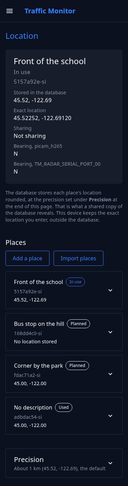
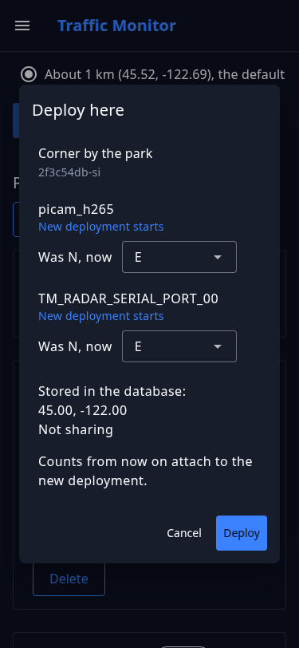

# Places and location

The control app's **Location** page records where the device is and which way its sensors face. It also sets how precisely the database stores the location. Only the administrator sees the page, because it shows exact coordinates. A device that stays in one place works without it, so use it when you move the device, turn it, or plan to share its data.

## Places and deployments

A *place* is somewhere the device has been, is, or will be. Each place has an id such as `3f9a1c2e-si`, an optional description that only you see, and an optional location, its latitude and longitude. A place doesn't need a location: a device with none still counts and records its data, only without saying where. One place can hold sensors that face different ways, such as a corner with a radar looking down each street.

One place is always **In use**. The others are **Planned**, entered ahead of a move, or **Used**, where the device has been. Claiming a new device creates its first place, **First location**, with no location.

Each sensor at a place, facing one way, for one stretch of time, is a *deployment*. Every count and reading is stored with its deployment, so you can tell where it was taken after the device moves. Moving to another place, or turning a sensor, starts a new deployment, and the earlier ones keep what they recorded.

The exact location is kept in the control app and in Node-RED's settings file, [`config.yml`](../configuration/node-red-config.md#deployment). The database stores the place's id and the location rounded to the [precision](#choose-the-precision) you choose.

## The Location page

**Location** is in the control app's menu, after **Detection**. The card at the top shows the place in use: its description, its id, the location as the database stores it, the exact location, whether the device shares its data with a [ThingsBoard](../data-and-payloads/integrations.md) server, and the way each sensor faces. Under it, a note says how the database stores the location. Then come the list of places and, last and closed, the [precision](#choose-the-precision), with the current choice beside its title.

{ width="300" }

Each place in the list shows its description, or **No description**, its mark (**In use**, **Planned**, or **Used**), its id, and its location as the database stores it. Select a place to open it. An open place shows:

* **Imported from your previous settings** for a place that came from an older version's data; see [Update the software](../build-your-own-device-diy/update.md#places-after-an-update).
* When the place was first and last used, or **Not used yet**.
* How many events were recorded there, and between which dates.
* Its deployments, newest first, grouped by when they were deployed: the sensors started together sit under one date, each with the way it faced and **Correct bearing**. A radar deployed with a camera is indented under it. A sensor that ended before the rest of its group says when.
* The buttons for what you can do with the place: **Deploy here** for a planned place, **Re-deploy here** for a used one, or **Modify deployment** for the place in use; **Edit** for a planned place; **Correct location** for a used place or the place in use that has a location; and **Delete** for any place but the one in use.

**Before any place was recorded** counts the deployments that had already ended when the device got its first place. They belong to no place, and the database keeps them as they are. Deployments still running then joined that first place.

If Node-RED hasn't answered yet, as right after an update, a warning at the top says past places may be missing. Reload the page once Node-RED is running. Opening the control app's home page or Status page sets the places up too.

## Add a place

Choose **Add a place**, fill in what you know, and **Save**. The place is added as planned.

* **Description**: a name for the place, such as "Front of the school". It never leaves the device.
* **Coordinates**: the latitude and longitude, pasted from a maps app as one value, such as `45.52252, -122.69120`. Use a dot as the decimal mark. The device keeps five decimal places, about a metre. Leave the field empty for a place with no location.
* **Which way each sensor faces here**: `N`, `NE`, `E`, `SE`, `S`, `SW`, `W`, `NW`, or **Not set**, for each sensor turned on in the settings.

**Use this phone's location** fills in the coordinates from your phone's location. Browsers share a location only with pages opened over HTTPS, and the device uses plain HTTP, so the form usually says to paste coordinates instead.

To change a planned place, open it and choose **Edit**. A place that has been used can't be edited; [correct it](#correct-a-wrong-location-or-bearing) instead.

## Move or turn the device

When the device moves to another place, record it from that place: **Deploy here** if the place is planned, or **Re-deploy here** if the device has been there before. When a sensor is turned to face another way, record it with **Modify deployment** on the place in use.

1. Open the place, and choose its button.
2. Check the review. For each sensor, it says whether a new deployment starts, the way the sensor faced before, and the way it faces now, which you can change. Under the sensors are what the database will store for the place and whether the device shares its data.
3. Choose **Deploy**, **Re-deploy**, or **Modify**.

{ width="300" }

The page waits while Node-RED starts the new deployments, then lists their ids, each with **Copy**. Counts from then on belong to the new deployments.

In **Modify deployment**, the review starts with each sensor's bearing as it is, and each sensor reads **Unchanged** until you change its bearing. **Modify** stays off until at least one bearing changes, and only the sensors you turned start a new deployment.

!!! warning "Don't deploy twice"

    If Node-RED hasn't loaded the new settings within about 20 seconds, the page says the settings are saved and the deployments appear once Node-RED loads them. If the connection drops while the page waits, it says the settings may already be saved. In both cases, close the dialog and check the place in the list before you deploy again.

A move usually also needs the camera's zones adjusted; see [First-time setup](../setup-guide.md#3-adjust-the-zones).

## Correct a wrong location or bearing

A correction is for a value that was entered wrong. It changes what the records already say, and starts no new deployment. If the device moved or was turned, [record that](#move-or-turn-the-device) instead.

* **Correct location**, on a used place or the place in use, takes a new latitude and longitude. Every record from the place then says it was at the new point, rounded to the precision each was stored at. For the place in use, `config.yml` takes the new point too. A point more than about 1 km from the old one looks like a move, so the page asks a second time and gives the distance. A place with no location can't be corrected to one: add a new place with the location, and deploy it.
* **Correct bearing**, on each deployment in an open place, takes the way the sensor really faced. Every record from that deployment then says so. For a deployment that is still running, `config.yml` takes the new bearing too.

Each correction can have a **Reason**, which is kept with the correction on the device. Copies of the database already downloaded, and data already uploaded, keep the old values.

## Import places from a file

To plan several places at once, choose **Import places**. Pick a CSV file, or paste its lines into the box.

* The first line is the header. It starts with `description,lat,lon`, then has one column for each sensor turned on in the settings, named as in the settings. The dialog shows this device's header.
* Each further line is one place. Leave `lat` and `lon` both empty for a place with no location. A sensor's column holds the way it faces, `n`, `ne`, `e`, `se`, `s`, `sw`, `w`, or `nw`, or nothing.
* A file can be up to 64 KiB.

For a device with the Pi camera and one radar:

```text
description,lat,lon,picam_h265,TM_RADAR_SERIAL_PORT_00
Front of the school,45.52252,-122.69120,n,n
Corner by the park,,,e,e
```

Choose **Preview** to see the places the file holds and, by line number, any lines with a problem. **Import** adds the places as planned. It's offered only when every line can be read, and it adds all of them or none.

## Delete a place

Open the place and choose **Delete**, then confirm. A planned place is removed from the list. A used place's exact location is deleted with it, and the database keeps the rounded location stored with each of its records. Deleting can't be undone.

The place in use can't be deleted. Deploy another place first.

## Choose the precision

**Precision**, at the end of the page, sets how much of the location the database stores. It's closed until you open it, because most devices never need to change it. The setting is for the whole device: every place, the deployments running now, and every new one. Each choice shows how the same point would be stored:

| Choice | The database stores |
|---|---|
| **No location stored** | No coordinates |
| **About 10 km** (45.5, -122.7) | One decimal place, about a city |
| **About 1 km** (45.52, -122.69), the default | Two decimal places, about a neighborhood |

The exact location is never stored in the database. It stays on this device, so a later update can still export it in full. Choose one and **Save**.

* **A coarser choice** applies to the deployments running now at once. Rows stored before them keep their precision unless you tick **Also round the rows already stored**, which asks first, because it can't be undone.
* **No location stored** removes the stored location from the deployments running now at once. Tick **Also remove it from the rows already stored** to remove it from every row in the database as well, which also asks first. The exact location stays on the device, but the database can't get the rounded values back.
* **A finer choice** applies from the next deployment. Rows already stored stay as they are, because what was rounded away can't come back.

## What leaves the device

* A place's description, and the reasons you give for corrections, never leave the device.
* A copy of the database holds the place's id and its location at the stored precision: about a neighborhood at about 1 km, or about a city at about 10 km. The exact location isn't in it.
* A correction or a coarser precision changes the device's own records only. Copies of the database already downloaded, and data already uploaded, keep the values they had.

To change these values in `config.yml` by hand, see [Edit the location by hand](../configuration/node-red-config.md#edit-the-location-by-hand).
