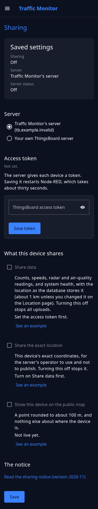

# Share data

A Traffic Monitor shares nothing until an administrator turns it on. The control app's **Sharing** page, in its menu, is where an administrator downloads a copy of the device's data to the computer or phone they are using, and where they set what the device uploads to a server and what goes with it. Everyone who is logged in can see what the device shares and how the server last answered. Only the administrator can download the data or change anything.

{ width="300" }

## Download your data

The **Download your data** card is the first thing on the page, and only an administrator sees it. It saves a copy of the device's database on the computer or phone you're using. Nothing is uploaded, and the page works the same whether or not **Share data** is on. The card shows the **Database size** and has one box, **Include each place's exact location**, and one **Download** button.

Choose **Download** and read the question. It says what the file holds: everything in the device's database, which is the events, radar readings, and air quality readings it recorded, its deployments, its watch log and setup history, and any comments. It says that each place's location is in it as the database stores it, rounded, and that the file holds no exact location, no pictures or video, and no passwords or tokens. Nothing is asked of the device until you choose **Download** in the question; **Cancel** closes it.

The device then makes a consistent copy of the database, so the download starts after a wait, which can take a few minutes for a large database, and the card says so. The copy needs free space about the size of the database, as the [Data export](../ui/database.md#download-the-database) page's download does. If the device can't make the copy, the browser has already left the Sharing page and shows a plain text page with the reason instead of a file: go back to the Sharing page, and reload it before you try again. Once a download has started, **Download** and the box stay off until you reload the page, so that a second copy isn't started by mistake while the first is still being made.

The file is named `<hostname>_<time>_tmdb.tar.gz` and holds `tmdb.sqlite`. It is the same file as the **Download the database** button on the Data export page. On a phone joined to the unit's hotspot, see [Phones](wifi-hotspot.md#phones) for how downloads save.

### Include each place's exact location

Tick **Include each place's exact location** to get a copy that also holds where the device was. Use it when the person who analyzes the data should map it at the real places, and a separate list of places to match by id would be one more step. Its question carries a warning: this copy of the database includes the exact location of each place the device has been at, the database on the device keeps its rounded locations, and you should give the copy only to someone who should know where the device was.

The box is unticked whenever the page opens. It is off, with the reason under it, until a place the device has been at, one marked **In use** or **Used** on the [Location page](location.md), has a location. A planned place doesn't count, because the device was never there.

That file is named `<hostname>_<time>_tmdb-exact-locations.tar.gz` and holds `tmdb-exact-locations.sqlite`. The name says what it is, so nobody takes it for the database you can share.

### What the copy adds

The copy with exact locations is the database as it is, with two more things in it:

* The table `survey_exact_location` has one row for each place: its id, and its exact latitude and longitude.
* The view `deployment_exact` is the `deployment` table with two more columns, `exact_lat` and `exact_lon`, from the place the row names.

The `deployment` table itself is not changed. Its `lat` and `lon` still hold the location rounded to the [precision](location.md#choose-the-precision) stored with each row, so a script that reads them gets the rounded location from every file, and an exact point can't be picked up by mistake. To list where the device was and when, with each deployment's sensor, start, end, and exact point:

```sql
SELECT sensorName,
       datetime(entryStartDateTime / 1000, 'unixepoch') AS started,
       datetime(entryEndDateTime / 1000, 'unixepoch') AS ended,
       exact_lat, exact_lon
FROM deployment_exact
ORDER BY entryStartDateTime;
```

The times are in UTC, and `ended` is empty for a deployment that is still running. A place has one exact point, so this covers every place the device has been at, past ones included, and not only the one in use.

The table holds the places the device has been at that have a location. A planned place is never in it, and neither is a place the database doesn't name. The view's `exact_lat` and `exact_lon` are empty for:

* A place with no location.
* A place the control app no longer has, because you deleted it.
* A deployment from [before any place was recorded](location.md#the-location-page), which names no place.

A [correction](location.md#correct-a-wrong-location-or-heading) shows in the copy as corrected: the place has one point, and a corrected place has the new one, with its rows' rounded location corrected the same way. A copy you downloaded earlier keeps the values it had, so two copies of the same device can differ, and the newer one is right. The copy doesn't hold the record of corrections.

The database on the device is unchanged: it never holds the table or the view, and the **Download the database** button on the [Data export](../ui/database.md#download-the-database) page still saves rounded locations only. The device removes its working copy when the download ends. The file you saved says where the device was, so give it only to people who should know. The table holds what the [`exact_location`](../data-and-payloads/data-overview.md#the-exact-location-in-a-database-copy) attribute holds when you share the exact location.

## Choose the server

| Server | What differs |
|---|---|
| **Traffic Monitor's server** | The default. Before you turn sharing on, or add a choice to it, you read the notice that says what is done with the data. The public map choice is offered only for this server. |
| **Your own ThingsBoard server** | You give its host, its protocol (`https` or `http`), and, if it isn't on the standard port, its port. The notice and the public map don't apply to it. Once data leaves the device, it's your responsibility to make that server honour the choices you make on this page. |

Changing the server turns off the exact location and the public map. Each choice is given for one server, so tick them again for the new one.

## Set the access token

The server gives each device an access token. Enter it in **Access token** and choose **Save token**. The page says whether a token is set and its last four characters, and never shows it back. A token takes letters, digits, and `. _ ~ -`, and is up to 256 characters long.

Saving the token restarts Node-RED, which takes about thirty seconds. The device counts nothing while it restarts. **Share data** can't be ticked until a token is set.

## Choose what the device shares

Each of the three choices starts off, is ticked on its own, and is turned off in the same place: untick it and choose **Save**. **See an example** under each one shows what is sent, with made-up values.

| Choice | What it sends | What it doesn't send |
|---|---|---|
| **Share data** | Each [event](../data-and-payloads/events-payload.md) with its speed and direction, its [path](../data-and-payloads/object-paths.md) across the camera's picture, its box, and how long it [stood still and spent in each zone](../data-and-payloads/events-payload.md#time-stopped-and-time-in-each-zone), the [radar](../data-and-payloads/radar-payload.md) and [air quality](../data-and-payloads/air-quality-aq-payload.md) readings, every five minutes whether each camera and radar was working (the [watch log](../data-and-payloads/watch-log.md)), and the device's system health: its software versions, name on the network, time zone, serial number, temperature, and disk use. With them goes where the device is, as the database stores it: the place's id and its location rounded to about 1 km, unless you chose another [precision](location.md#choose-the-precision), and how each sensor is mounted: the way it faces and, when you have recorded them, its tilt, height, the distance to the centre of its view, and its usual mount. Only the fields on the list of what is shared are sent, so any other column of a deployment stays on the device. Turning this off stops every upload. | Images, video, plate reads, the device's settings, its Wi-Fi details, and the descriptions you give places. |
| **Share the exact location** | The exact coordinates of the place in use, with its id. For Traffic Monitor's server, the notice says how they are used; for your own server, that is up to whoever runs it. It needs **Share data**, and over your own server it needs `https`. Nothing is sent until the place in use has a location. | Any place but the one in use. |
| **Show this device on the public map** | A point rounded to about 100 m, and nothing else about where the device is. It needs **Share data**, and it's offered for Traffic Monitor's server only. The box says **Not live yet** until a release opens the map. | The exact location. |

For Traffic Monitor's server, the page requires you to read the notice, and to tick **I've read the notice**, when a save turns **Share data** on, switches to Traffic Monitor's server, or adds a choice under a notice that has changed. A save that only keeps or turns off choices never requires it. When the notice changes, the device keeps sharing as you set it, and, while **Share data** is on, the page offers **I've read the notice** until someone ticks it and saves. Ticking it and choosing **Save** records your choices under the new version, and the Status page stops asking. A choice you add after the change waits for you to read it.

!!! info "The exact location is for you to give or keep"

    The database stores the location rounded, so a shared copy of the database carries the rounded location only. The exact location leaves the device only under **Share the exact location**, or in what you save yourself: the copy of the database from [**Download your data**](#download-your-data) with **Include each place's exact location** ticked, or the file from [**Export exact locations**](location.md#export-the-exact-locations) on the Location page. You give those yourself, and nothing is sent.

## What the server already has

Turning a choice off stops the device sending. What the server already received stays there. To ask for it to be deleted, use the email address in the notice (for Traffic Monitor's server) or ask the operator of your own server.

## Check that the server gets the data

The **Server status** line on the Sharing page, and the **Sharing server** check in the Apps group of the [Status page](device-health.md#the-status-page), say how the server last answered. The device checks again after a save while it waits for the first upload. The control app never contacts the server itself: Node-RED records how each upload went.

| Status | Meaning and what to do |
|---|---|
| Off | Nothing is uploaded. |
| Waiting for the first upload | Sharing is on and no upload has been sent since the settings loaded. The device sends system health every five minutes. |
| Accepted an upload 4 minutes ago | The server is taking the data. |
| No upload accepted for a while | The server hasn't accepted an upload for more than 15 minutes. Check the device's internet connection on the [Network page](wifi-hotspot.md#the-network-page). |
| Can't be reached | The device couldn't reach the server. The device keeps counting and recording, and an upload that fails isn't sent again, so the server misses what the device sent while it was offline. This is a warning, because an offline device is normal. |
| Refused the token | The server doesn't accept this device's token. The Status page's **Check the token** link opens the token's section. This is a problem. |
| Refused an upload | The server turned down what the device sent. Ask the server's operator. This is a problem. |
| Answered with an error | The server had an error. This is a warning; it usually passes. If it doesn't, ask the operator. |
| Not known | Node-RED isn't answering, so the status isn't known. See the Node-RED check in the Apps group. |

The **Sharing** check, in the Configuration group, says what is shared: **Not sharing**, **Sharing data**, or **Sharing data and the exact location**, and whether the public map is on. It's a warning, with a **Review sharing** link, when the page needs a look: after an [update](#after-an-update), when no one has read the notice yet or it has changed, or when the [`sharing` block](../configuration/node-red-config.md#sharing) in `config.yml` has a value the device ignores. Opening the Sharing page and choosing **Save** rewrites that block.

## After an update

A device that already uploaded before it had these choices keeps uploading, with the location as the database stores it. The exact location stops until an administrator turns it on. The first time someone opens the Status, Location, or Sharing page, the control app adds a `sharing` block to `config.yml` that records this, with the exact location and the public map both off. Node-RED reloads its settings once when that happens. The Status page shows **Review sharing** until an administrator chooses **I've reviewed this** on the Sharing page or saves the page. Until an administrator ticks **I've read the notice** and saves the page, the Sharing check also says so.

The upload of the device's settings, and the Backup & Restore section of the legacy dashboard, are removed while they are reworked.

An old `config.yml` that still has the placeholder server `tb.server.com`, with the upload off, gets Traffic Monitor's server when the installer runs.

## What the installer's `-f` does to sharing

Running the installer with `-f` writes a fresh `config.yml` with the upload off and no `sharing` block, so every choice is turned off, and none is restored afterwards. The access token stays, because the device keeps it with its other secrets. Turning the upload back on by editing the file shares the rounded data only, whether or not anyone opened a page in between: the exact location and the public map are never turned on from the file. The control app then writes the `sharing` block back with both turned off. Choose them again on this page.

## Where it's stored

The page writes the server and the choices to [`config.yml`](../configuration/node-red-config.md#thingsboard), and keeps a record of each choice, with when it was made and which notice it was under, in the control app's own database. The `config.yml` copy is what Node-RED reads, so a choice you make by editing the file has no effect.
